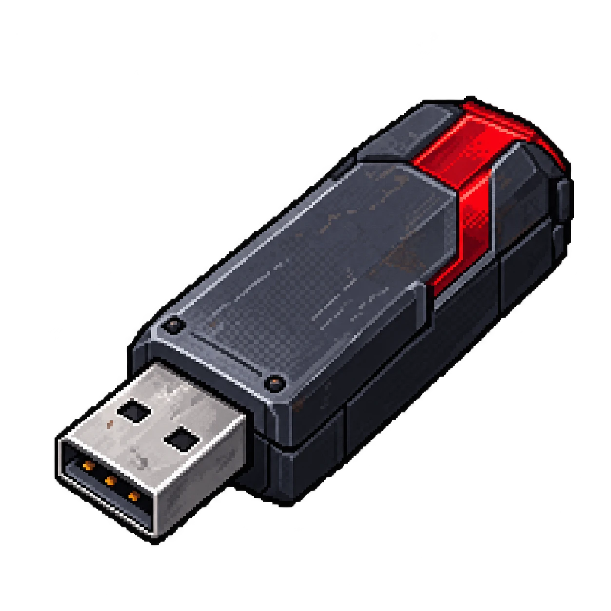
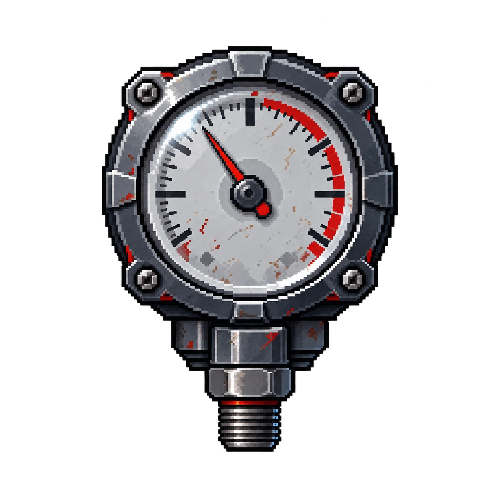

# Itens investigativos — AMOSTRA 47

O caso lista **seis itens investigativos**. A **ordem de manutenção da ventilação** é uma evidência central ligada a Beatrice Salles e entra aqui como sétimo objeto visual, sem fazer parte da lista original.

Cada item revela uma informação específica e ajuda a confirmar ou eliminar pelo menos uma hipótese. A arte segue o [guia de estilo dos objetos](GUIA_ESTILO_OBJETOS_AMOSTRA47.md).

## Visão geral

| ID | Item | Proposição | Personagem ligado | Local sugerido* |
|---|---|---|---|---|
| OBJ-01 | [Crachá de acesso](#obj-01--crachá-de-acesso) | — | [Giovani Pistori](../personagens/giovani-pistori/) | [Central de segurança](../locais/central-de-seguranca/) |
| OBJ-02 | [Pendrive criptografado](#obj-02--pendrive-criptografado) | Z | [Angela Torres](../personagens/angela-torres/) | [Sala de servidores](../locais/sala-de-servidores/) |
| OBJ-03 | [Gravador de áudio](#obj-03--gravador-de-áudio) | Q | [Fernando Almeida](../personagens/fernando-almeida/) | a definir |
| OBJ-04 | [Frasco de contenção](#obj-04--frasco-de-contenção) | — | [Clara Costa](../personagens/clara-costa/) | [Câmara de contenção](../locais/camara-de-contencao/) |
| OBJ-05 | [Relatório de acesso](#obj-05--relatório-de-acesso) | W | [Otávio Ferraz](../personagens/otavio-ferraz/) | [Central de segurança](../locais/central-de-seguranca/) |
| OBJ-06 | [Sensor de pressão](#obj-06--sensor-de-pressão) | U | [Clara Costa](../personagens/clara-costa/) | [Câmara de contenção](../locais/camara-de-contencao/) |
| OBJ-07 | [Ordem de manutenção](#obj-07--ordem-de-manutenção-da-ventilação) | V | [Beatrice Salles](../personagens/beatrice-salles/) | [Túnel de ventilação](../locais/tunel-de-ventilacao/) |

\* O caso não define em que sala cada item é encontrado. A coluna mostra a sugestão mais coerente com os mapas, que ainda precisa ser confirmada.

---

## OBJ-01 — Crachá de acesso

**O que revela:** permite reconstruir quem entrou nos setores restritos e em quais horários.

**Na investigação:** complementa o relatório de acesso. Ajuda a separar credenciais internas de uma entrada não autorizada.

---

## OBJ-02 — Pendrive criptografado

**O que revela:** uma cópia parcial dos registros do experimento e informações recuperadas dos sistemas, incluindo o **registro decisivo da autorização administrativa** feita com a conta da direção.

**Na prova:** premissa 14, S → Z. Com S (premissa 4), Modus Ponens dá **Z** (linha 29), um dos quatro termos da conclusão final.

---

## OBJ-03 — Gravador de áudio

**O que revela:** uma conversa entre funcionários antes do alarme geral.

**Na prova:** é a origem da premissa 2, **Q**: Fernando Almeida solicitou a antecipação do experimento. Q faz parte do antecedente da premissa 9, que leva a X.

---

## OBJ-04 — Frasco de contenção

**O que revela:** ajuda a verificar se houve retirada manual da amostra e a reconstruir o estado da câmara. Na arte, o frasco está **vazio**.

**Na investigação:** reforça a leitura da Câmara de contenção, onde a contenção foi rompida por manipulação técnica, e não por arrombamento.

---

## OBJ-05 — Relatório de acesso

**O que revela:** horários, setores visitados e tentativas de entrada.

**Na prova:**
- origem da premissa 8, **W**: Otávio saiu antes da liberação. Com O → ¬W, Modus Tollens dá **¬O**.
- base da premissa 10, **Y ∨ O ∨ B ∨ I**: só quatro hipóteses são compatíveis com os registros.

---

## OBJ-06 — Sensor de pressão

**O que revela:** alterações nas condições de contenção antes do incidente.

**Na prova:** confirma a premissa 6, **U**: Clara registrou a alteração manual dos parâmetros. Com U → K, Modus Ponens dá **K**: tudo começou na Câmara de contenção.

---

## OBJ-07 — Ordem de manutenção da ventilação

**O que revela:** uma ordem de serviço da ventilação com inconsistências, que **não partiu de Beatrice Salles**.

**Na prova:** origem da premissa 7, **V**. Com B → ¬V, Dupla Negação e Modus Tollens dão **¬B**.

---

## Pendências

- Confirmar em que local cada item é encontrado e quais itens só aparecem depois de outros.
- Trocar o símbolo que reproduz o logo da Umbrella (*Resident Evil*) no crachá, na ordem de manutenção e na sinalização por um símbolo próprio do Complexo Helix.
- Produzir as versões de mundo (top-down) e os PNGs transparentes de cada item.
