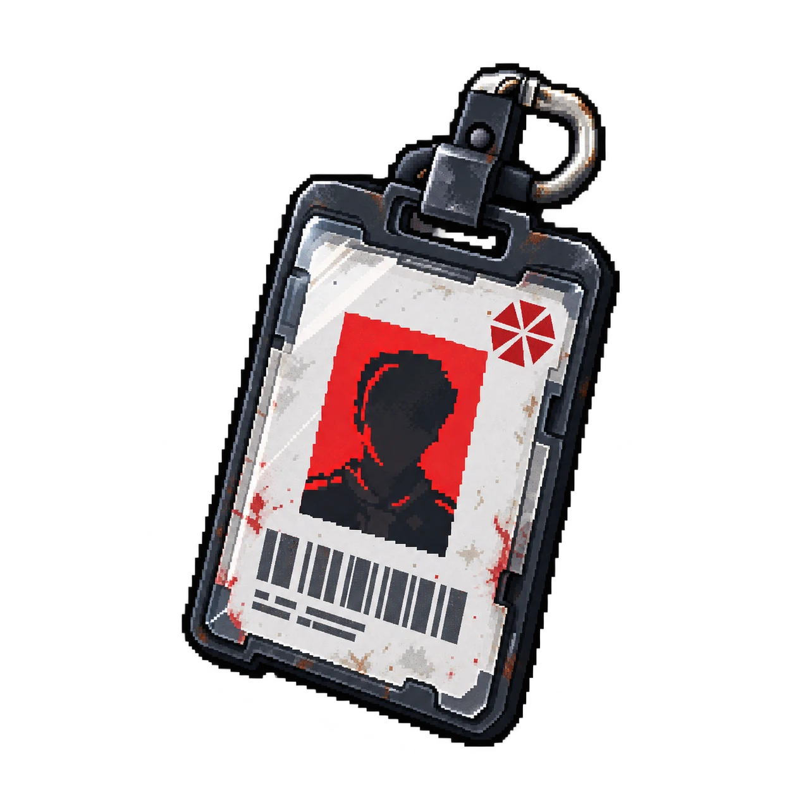

# OBJ-01 — Crachá de acesso

| | |
|---|---|
| **ID** | OBJ-01 |
| **Personagem ligado** | [Giovani Pistori](../../personagens/giovani-pistori/) |
| **Local sugerido\*** | [Central de segurança](../../locais/central-de-seguranca/) |
| **Proposições** | — |

## O que revela

Permite reconstruir quem entrou nos setores restritos e em quais horários.

## Na investigação

Complementa o relatório de acesso. Ajuda a separar credenciais internas de uma entrada não autorizada.

\* O caso não define em que sala o item é encontrado; a sugestão ainda precisa ser confirmada.
