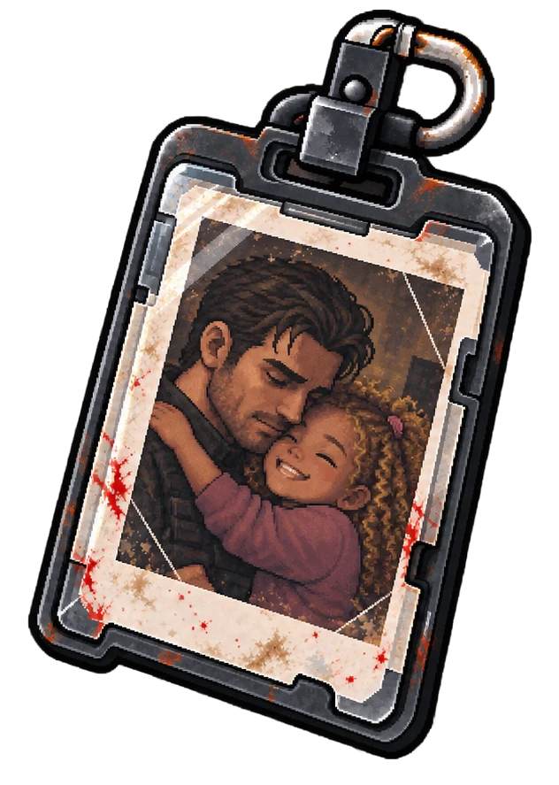

# OBJ-01 — Crachá de acesso

É também o **item pessoal de Giovani Pistori**.

| Frente | Verso |
|---|---|
|  |  |

| | |
|---|---|
| **ID** | OBJ-01 |
| **Dono** | [Giovani Pistori](../../personagens/giovani-pistori/) |
| **Onde** | [Central de segurança](../../locais/central-de-seguranca/) |
| **Ordem** | Um dos primeiros itens encontrados |
| **Proposições** | — |

## O que revela

Permite reconstruir quem entrou nos setores restritos e em quais horários.

## O crachá do pai

De um lado, a **foto funcional** de Giovani. Do outro, uma **foto dele abraçado à filha, Giulia**, ainda criança. Para a protagonista, é o primeiro contato com o pai dentro do complexo.

Na arte do verso, a foto é um retrato instantâneo desgastado, com manchas de sangue nas bordas do porta-crachá: Giovani, de cabelo castanho e barba por fazer, abraça Giulia, que sorri de olhos fechados, com cabelo cacheado claro e blusa rosa.

## Na investigação

Complementa o relatório de acesso. Ajuda a separar credenciais internas de uma entrada não autorizada.
