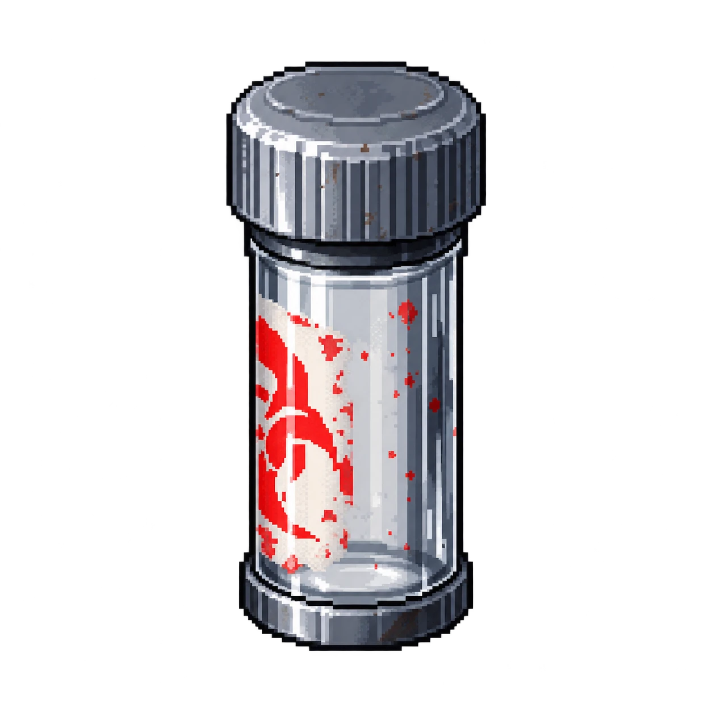

# OBJ-04 — Frasco de contenção

| | |
|---|---|
| **ID** | OBJ-04 |
| **Personagem ligado** | [Clara Costa](../../personagens/clara-costa/) |
| **Local sugerido\*** | [Câmara de contenção](../../locais/camara-de-contencao/) |
| **Proposições** | — |

## O que revela

Ajuda a verificar se houve retirada manual da amostra e a reconstruir o estado da câmara. Na arte, o frasco está **vazio**.

## Na investigação

Reforça a leitura da Câmara de contenção, onde a contenção foi rompida por manipulação técnica, e não por arrombamento.

\* O caso não define em que sala o item é encontrado; a sugestão ainda precisa ser confirmada.
