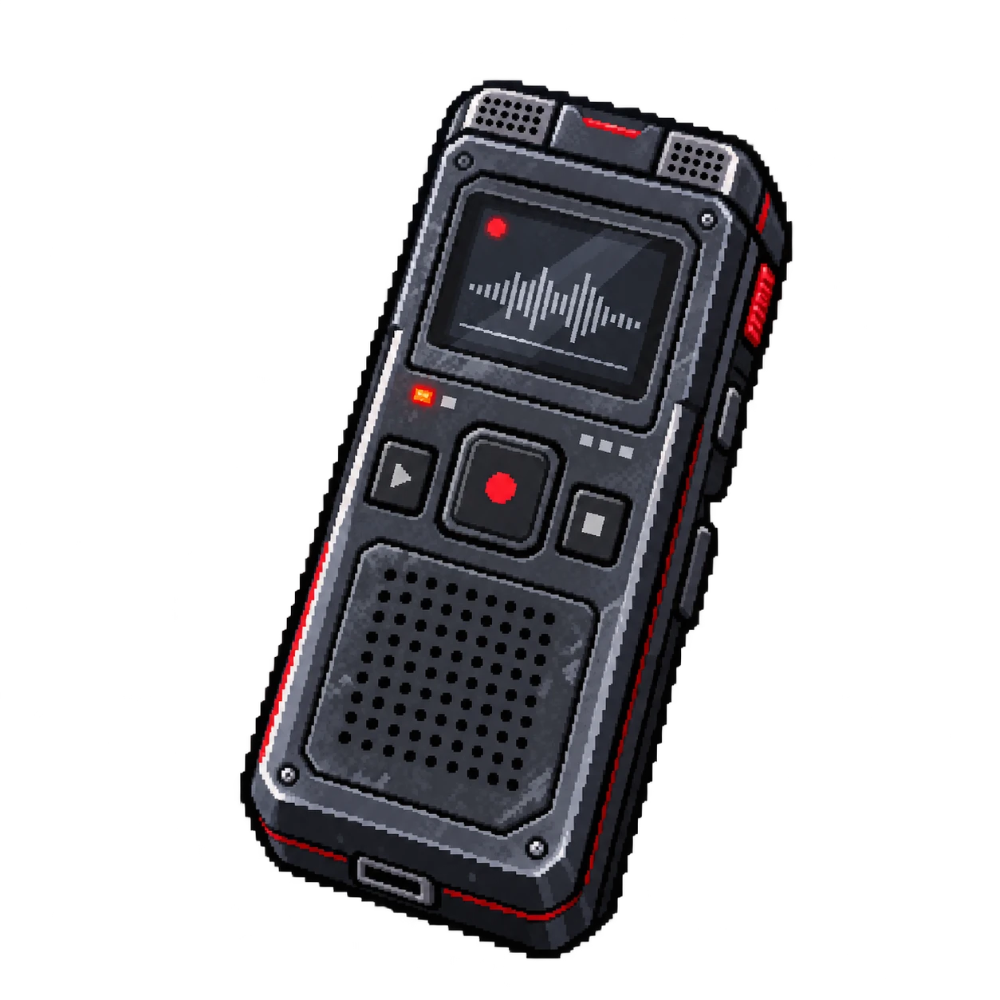

# OBJ-03 — Gravador de áudio

| | |
|---|---|
| **ID** | OBJ-03 |
| **Personagem ligado** | [Fernando Almeida](../../personagens/fernando-almeida/) |
| **Local sugerido\*** | a definir |
| **Proposições** | Q |

## O que revela

Uma conversa entre funcionários antes do alarme geral.

## Na prova

É a origem da premissa 2, **Q**: Fernando Almeida solicitou a antecipação do experimento. Q faz parte do antecedente da premissa 9, que leva a X.

\* O caso não define em que sala o item é encontrado.
