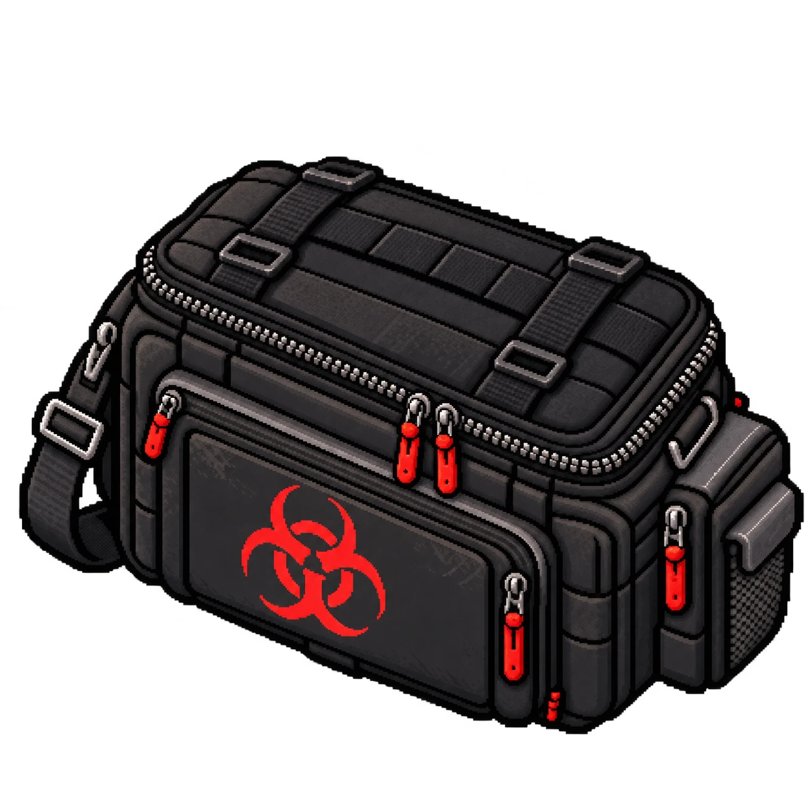
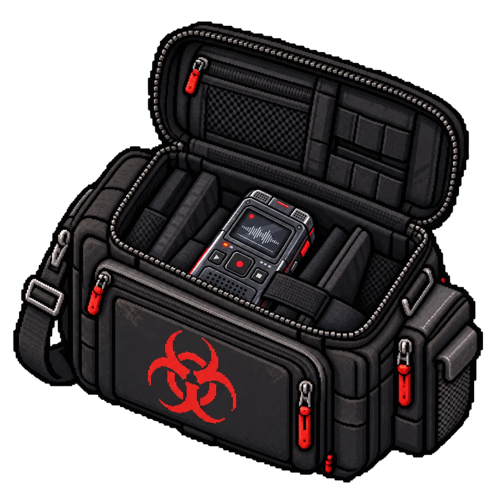

# Item pessoal — Bolsa de campo de Amie Lin

| Fechada | Aberta |
|---|---|
|  |  |

| | |
|---|---|
| **Dona** | [Amie Lin](../../../personagens/amie-lin/) |
| **Onde** | [Laboratório de análises](../../../locais/laboratorio-de-analises/), onde Amie morreu |
| **Contém** | [Gravador de áudio](../../gravador-de-audio/) (OBJ-03) |
| **Ordem** | Primeiro item pessoal |

## Como funciona

Giulia encontra a bolsa **fechada**. Ao abri-la, encontra o **gravador pessoal de Amie**, preso por uma alça no compartimento central.

## A arte

Bolsa de campo preta, com o símbolo de risco biológico em vermelho na frente, zíperes com puxadores vermelhos, alça de ombro e bolsos laterais. Aberta, mostra divisórias internas e o gravador encaixado no centro.
