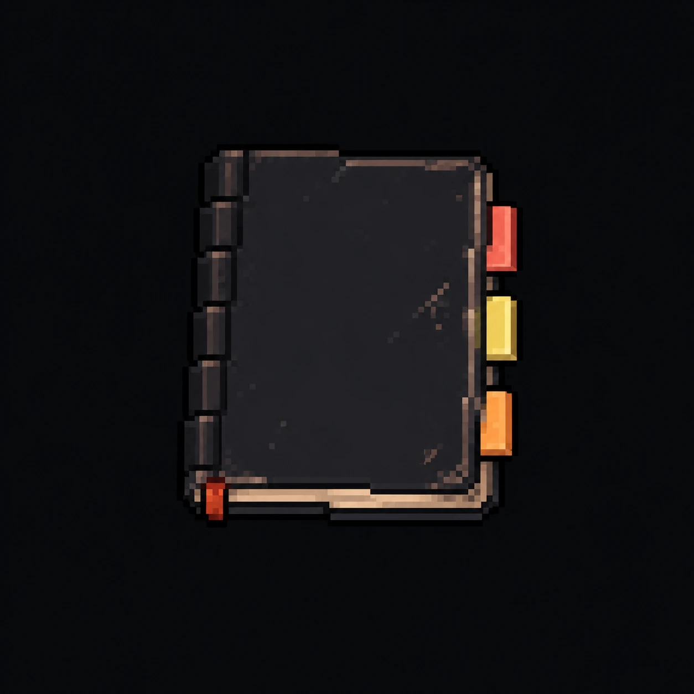
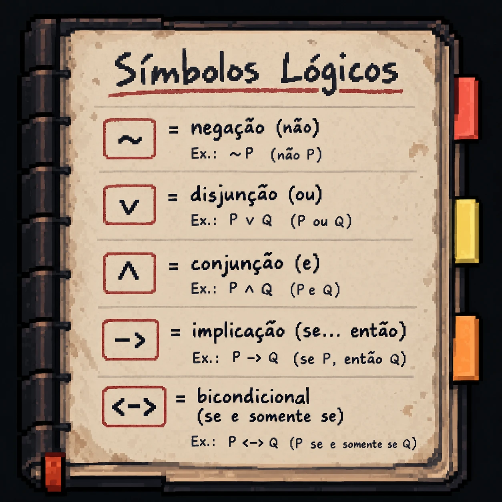

# Item pessoal — Caderno de anotações de Angela Torres

| Fechado | Aberto |
|---|---|
|  |  |

| | |
|---|---|
| **Dona** | [Angela Torres](../../../personagens/angela-torres/) |
| **Onde** | a definir |
| **Obrigatório** | Sim |
| **Contém** | Dicionário dos símbolos lógicos |

## Como funciona

É um item **obrigatório**: funciona como o dicionário que Giulia usa para ler e montar as proposições da investigação. A página aberta traz os cinco conectivos:

| Símbolo no caderno | Nome | Exemplo |
|---|---|---|
| `~` | negação (não) | ~P — não P |
| `v` | disjunção (ou) | P v Q — P ou Q |
| `^` | conjunção (e) | P ^ Q — P e Q |
| `->` | implicação (se... então) | P -> Q — se P, então Q |
| `<->` | bicondicional (se e somente se) | P <-> Q — P se e somente se Q |

## A arte

Caderno de capa preta gasta, com espiral na lombada, marcador vermelho e três abas coloridas (vermelha, amarela e laranja), o mesmo caderno do card de Angela. Aberto, mostra uma página de papel envelhecido com o título "Símbolos Lógicos" sublinhado em vermelho e cada símbolo dentro de um quadro vermelho, com nome e exemplo escritos à mão.
