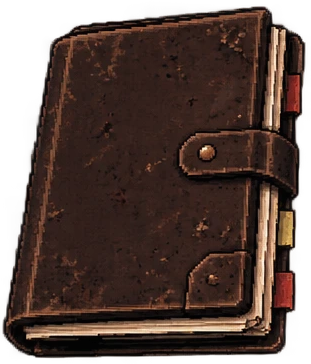
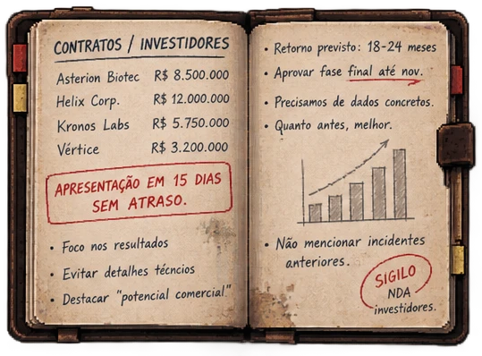
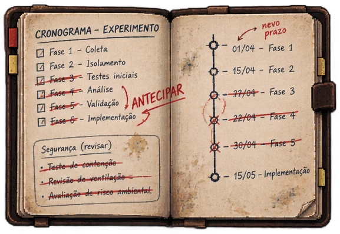
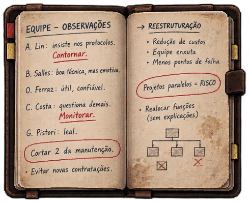
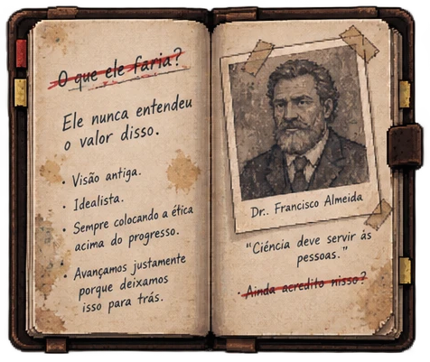
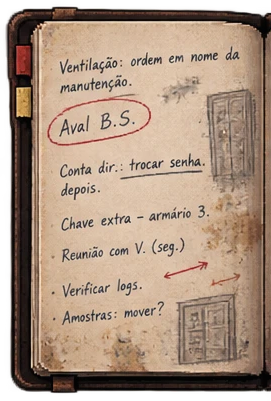
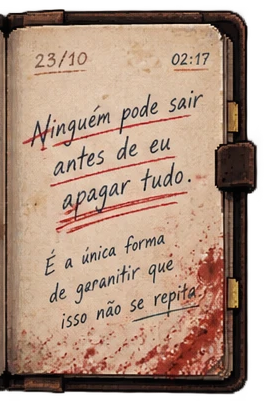

# Item pessoal — Caderno de Fernando Almeida

> ⚠️ **Contém pistas fortes sobre a solução do caso.**

| | |
|---|---|
| **Dono** | [Fernando Almeida](../../../personagens/fernando-almeida/) |
| **Onde** | Páginas espalhadas pelo complexo (qualquer local) |
| **Contém** | Seis páginas de anotações suspeitas |

## Como funciona

Giulia encontra o caderno com **páginas arrancadas**, espalhadas pelos locais do complexo. Cada página acrescenta uma parte da história. Sozinhas, elas levantam suspeitas, mas não provam a liberação: a solução continua dependendo da prova lógica.

A **página 6** é quase uma confissão de que o complexo foi trancado de propósito, por isso deve aparecer só no fim, depois de Giulia chegar à conclusão.

## As páginas

| # | Página | O que mostra | O que sugere |
|---|---|---|---|
| 1 |  | **Contratos / Investidores:** Asterion Biotec, Helix Corp., Kronos Labs e Vértice, com valores em reais; "Apresentação em 15 dias, sem atraso"; "Não mencionar incidentes anteriores"; "Sigilo — NDA investidores" | A pressa vinha do dinheiro |
| 2 |  | **Cronograma do experimento:** fases 3 a 6 riscadas e a palavra "ANTECIPAR"; datas riscadas com novo prazo; na caixa "Segurança (revisar)", teste de contenção, revisão de ventilação e avaliação de risco ambiental riscados | Ele mandou pular etapas de segurança (Q) |
| 3 |  | **Equipe — observações:** "A. Lin: insiste nos protocolos. Contornar."; "C. Costa: questiona demais. Monitorar."; "Cortar 2 da manutenção"; reestruturação com redução de custos | Via a equipe como obstáculo |
| 4 |  | **O pai:** "O que ele faria?" riscado; "Ele nunca entendeu o valor disso."; foto do Dr. Francisco Almeida com a frase "Ciência deve servir às pessoas." e, abaixo, "Ainda acredito nisso?" riscado | A ruptura com o legado de Francisco |
| 5 |  | **Fragmentos:** "Ventilação: ordem em nome da manutenção"; "Aval B.S."; "Conta dir.: trocar senha depois"; "Chave extra – armário 3"; "Reunião com V. (seg.)"; "Verificar logs"; "Amostras: mover?" | A manipulação do aval de Beatrice e da conta da direção (V, S) |
| 6 |  | **23/10, 02:17:** "Ninguém pode sair antes de eu apagar tudo. É a única forma de garantir que isso não se repita."; manchas de sangue | Ele trancou o complexo para esconder o que fez |

A [prancha original](prancha.png) com todas as páginas também está nesta pasta.

## Observações sobre a arte

- **Página 2:** a anotação "nevo prazo" parece um erro de grafia de "novo prazo".
- **Página 6:** a data **23/10** e a hora **02:17** são as primeiras indicações de quando o incidente aconteceu. Se forem mantidas, valem como cânone.
- **Página 5:** "Reunião com V. (seg.)" e "Chave extra – armário 3" são pistas novas, que ainda não têm ligação com o caso.
