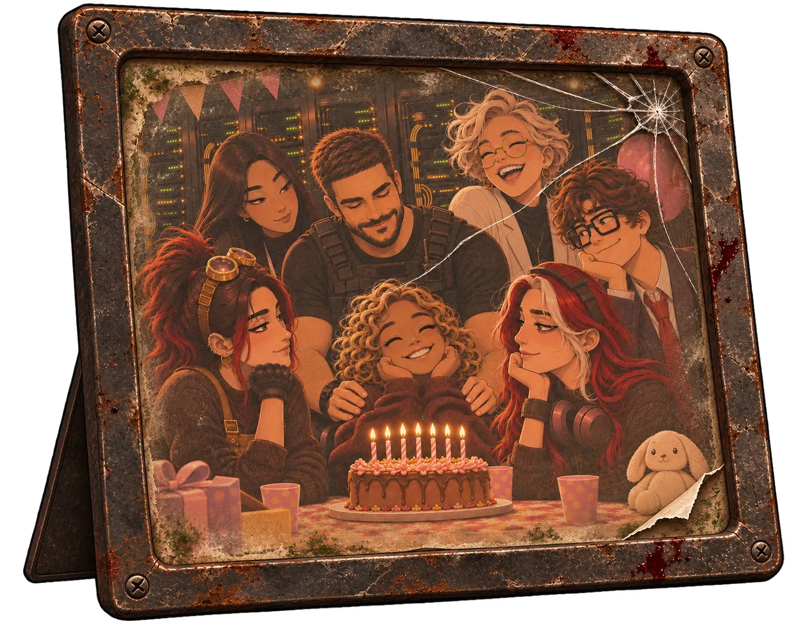

# Item pessoal — Foto da família do Helix

| | |
|---|---|
| **Dono** | A equipe do Complexo Helix |
| **Onde** | [Sala de servidores](../../../locais/sala-de-servidores/), num porta-retrato sobre a mesa da estação de Angela |
| **Contém** | — |

## O que é

Uma foto tirada na **festinha surpresa de sete anos de Giulia**, poucos meses antes do incidente, na Sala de servidores, organizada por Angela. Nela estão todos juntos: **Giovani, Angela, Amie, Beatrice, Clara e Otávio** e, no meio, **Giulia**, sorrindo, enrolada no cardigã marrom de lã do pai, quase sumindo dentro dele. Fernando não aparece: nunca fez parte daquela família.

A foto ficava presa num dos armários da sala.

## Por que está aqui

Angela imprimiu a foto e a colocou num porta-retrato de metal sobre a mesa da estação de trabalho dela. Ficou ali por quatorze anos, perto do pendrive que guardava a verdade, enquanto a sala apodrecia em volta.

## Na história

Giulia não lembra daquele dia. Ao encontrar a foto, se vê no meio de todos, enrolada no mesmo cardigã que está vestindo agora, e entende que naquela noite não perdeu só o pai: perdeu uma família inteira. A foto destrava um **flashback** da festinha.

É um item de ambientação e emoção: não está ligado a nenhuma premissa da prova lógica.

## A arte

Porta-retrato de mesa em metal escuro, enferrujado, com o vidro trincado em teia num canto e respingos de sangue seco na moldura. A foto, desbotada e manchada de umidade, tem um canto rasgado e dobrado. Dentro dela, a festinha na Sala de servidores: Giovani de colete tático com as mãos nos ombros de Giulia, enrolada no cardigã do pai, Angela rindo, Amie, Beatrice, Clara e Otávio em volta do bolo com sete velinhas. Fernando não aparece.
