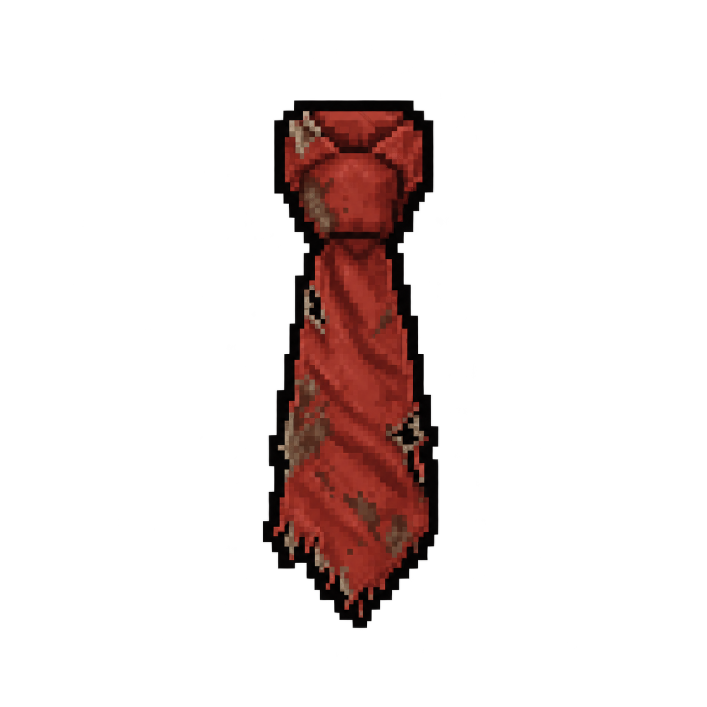

# Item pessoal — Gravata de Otávio Ferraz

| | |
|---|---|
| **Dono** | [Otávio Ferraz](../../../personagens/otavio-ferraz/) |
| **Onde** | [Sala de evacuação](../../../locais/sala-de-evacuacao/) |
| **Contém** | — |

## Por que está aqui

Otávio saiu do laboratório antes da liberação da amostra, mas ainda estava dentro do complexo quando ele foi trancado. Morreu perto de uma das portas, tentando fugir, e a gravata que era sua marca ficou na Sala de evacuação.

## A arte

A gravata estreita vermelho-terracota da ficha visual de Otávio, ainda com o nó feito. O tecido está manchado de sujeira, com rasgos e furos nas laterais e a ponta desfiada.
