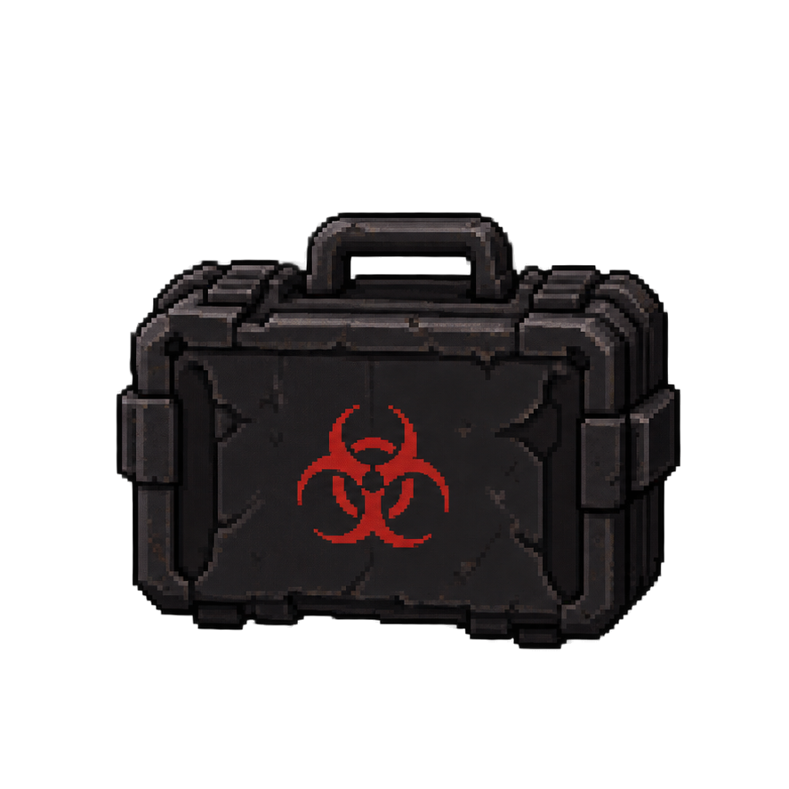
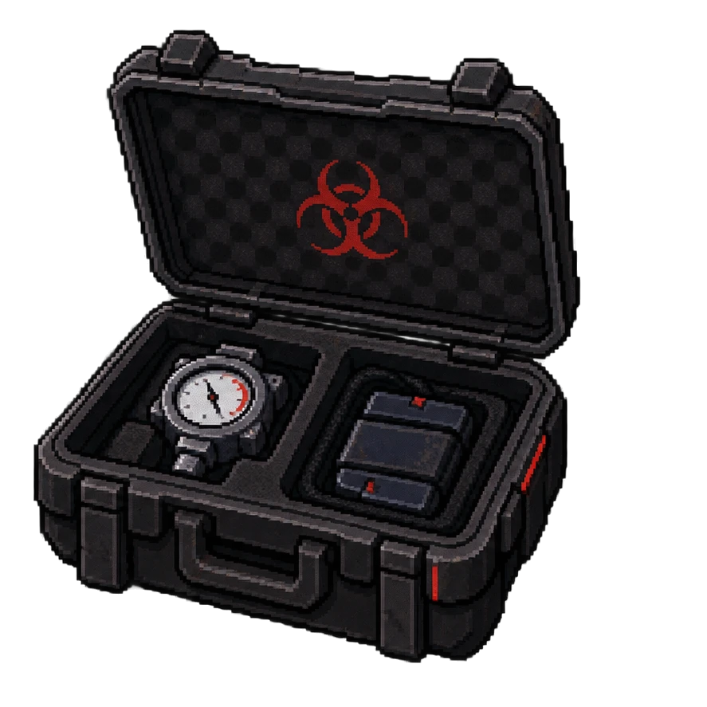

# Item pessoal — Maleta de amostras de Clara Costa

| Fechada | Aberta |
|---|---|
|  |  |

| | |
|---|---|
| **Dona** | [Clara Costa](../../../personagens/clara-costa/) |
| **Onde** | [Câmara de contenção](../../../locais/camara-de-contencao/) |
| **Contém** | [Sensor de pressão](../../sensor-de-pressao/) (OBJ-06) |

## Como funciona

Giulia encontra a maleta **fechada**. Ao abri-la, encontra o **sensor de pressão** que Clara usava para inspecionar a contenção, encaixado no compartimento da esquerda.

## A arte

Maleta rígida preta, desgastada, com alça, travas laterais e o símbolo de risco biológico em vermelho na frente. Aberta, mostra o símbolo também na tampa e o interior em espuma com dois compartimentos: à esquerda, o sensor de pressão (o mesmo manômetro de ponteiro vermelho da arte do item); à direita, um módulo escuro retangular com detalhes vermelhos, ainda sem função definida.
