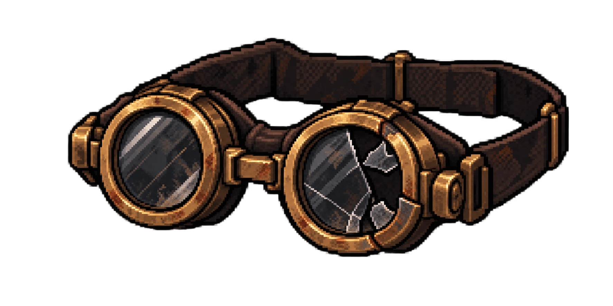

# Item pessoal — Óculos de proteção de Beatrice Salles

| | |
|---|---|
| **Dona** | [Beatrice Salles](../../../personagens/beatrice-salles/) |
| **Onde** | Dutos do [Túnel de ventilação](../../../locais/tunel-de-ventilacao/), onde Beatrice morreu |
| **Contém** | — |

## Por que está aqui

Quando o complexo foi trancado, Beatrice não correu direto para as portas. Voltou às áreas de manutenção para conferir se ninguém tinha ficado preso nos corredores de serviço e morreu nos dutos. Os óculos que ela sempre usava sobre a cabeça ficaram ali, quebrados.

## A arte

Os goggles de engenharia da ficha visual de Beatrice: aros redondos de bronze envelhecido, com ferrugem, e correia de couro marrom gasta. A lente esquerda está inteira; a **lente direita está estilhaçada**, com pedaços faltando, e o aro desse lado está rachado.
