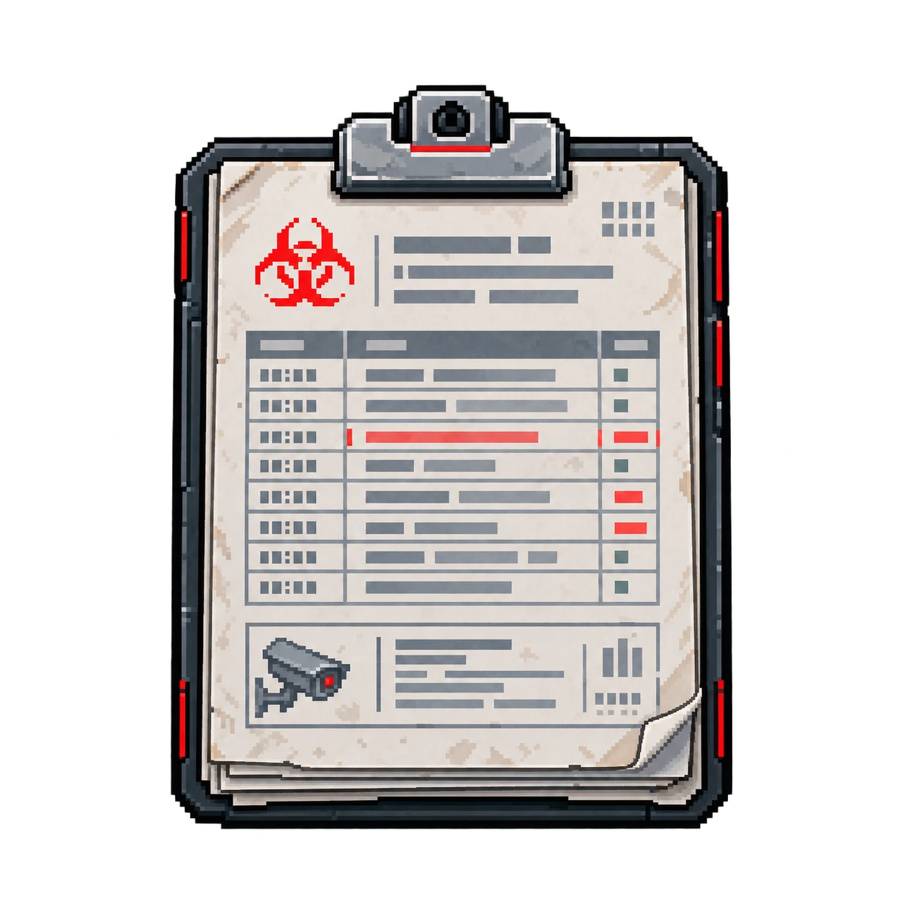

# OBJ-05 — Relatório de acesso

| | |
|---|---|
| **ID** | OBJ-05 |
| **Personagem ligado** | [Otávio Ferraz](../../personagens/otavio-ferraz/) |
| **Local sugerido\*** | [Central de segurança](../../locais/central-de-seguranca/) |
| **Proposições** | W; base da premissa 10 |

## O que revela

Horários, setores visitados e tentativas de entrada.

## Na prova

- Origem da premissa 8, **W**: Otávio saiu antes da liberação. Com O → ¬W, Modus Tollens dá **¬O**.
- Base da premissa 10, **Y ∨ O ∨ B ∨ I**: só quatro hipóteses são compatíveis com os registros.

\* O caso não define em que sala o item é encontrado; a sugestão ainda precisa ser confirmada.
