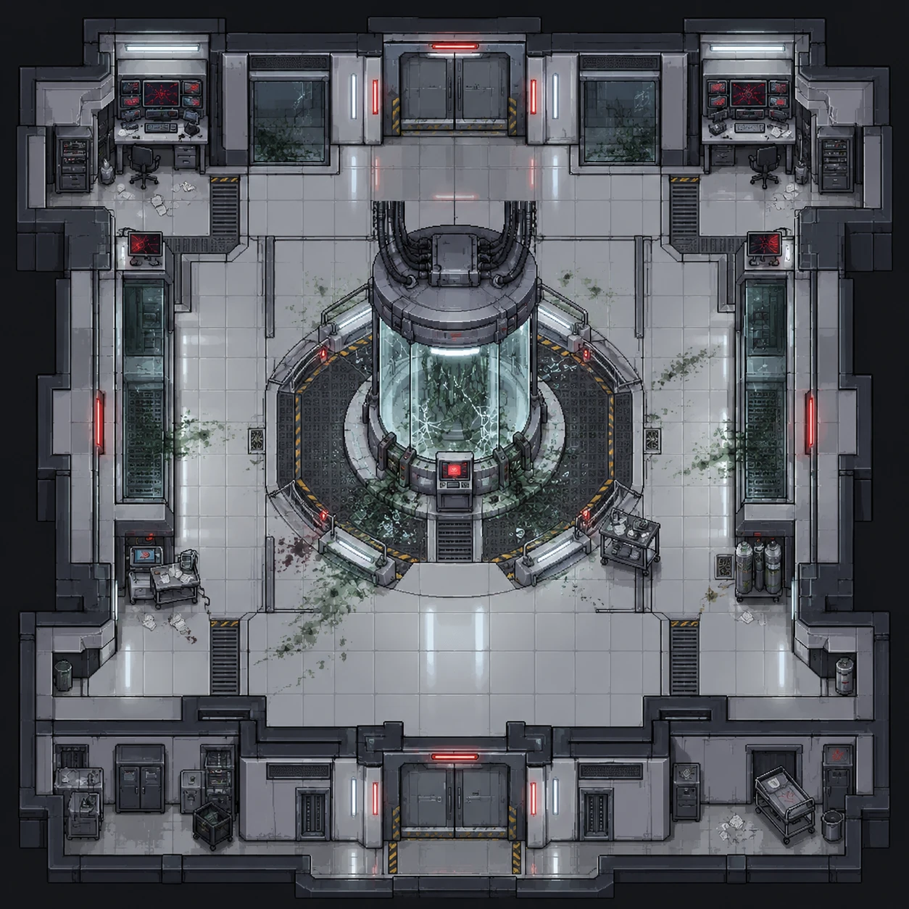
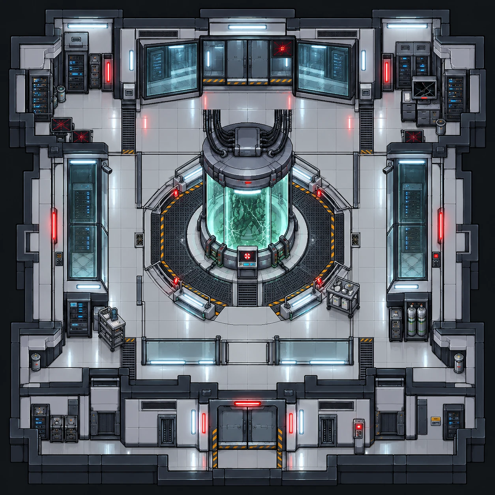

# Câmara de contenção

| Pós-incidente | Versão limpa |
|---|---|
|  |  |

| | |
|---|---|
| **Função no complexo** | Armazenamento da Amostra 47 |
| **Papel no caso** | Setor onde tudo começou |
| **Personagens ligados** | [Clara Costa](../../personagens/clara-costa/) (inspeção da contenção), [Amie Lin](../../personagens/amie-lin/) (acesso autorizado), [Giovani Pistori](../../personagens/giovani-pistori/) (depoimento sobre a ausência de arrombamento) |
| **Proposições** | K, U, T (≡ ¬A) |

## O espaço

Sala quadrada e simétrica, com duas portas duplas blindadas, uma ao norte e outra ao sul, marcadas por luzes vermelhas e faixas de segurança. **As portas estão intactas:** não há sinal de arrombamento na entrada.

- **Centro:** o tanque de contenção, um cilindro de vidro sobre uma plataforma circular de grade metálica cercada por guarda-corpos com luzes e faixas amarelas e pretas. Feixes de cabos descem do teto até a tampa do tanque. **O vidro está rachado** e há massa orgânica verde dentro dele.
- **Painel de controle:** fica na frente do tanque, com tela vermelha de alerta, logo acima de uma pequena escada de acesso à plataforma.
- **Rastro de contaminação:** manchas verdes saem do tanque e se espalham pelo piso, principalmente para oeste e leste. Perto da plataforma, à esquerda, há uma mancha escura de sangue.
- **Cantos superiores:** duas estações de monitoramento com várias telas vermelhas de alerta, cadeiras, racks e papéis no chão.
- **Parede norte:** janelas de observação com o vidro rachado e vegetação verde do outro lado.
- **Laterais:** painéis altos de vidro com equipamentos, cada um com um pequeno terminal de tela vermelha.
- **Pontos de apoio:**
  - carrinho com tablet e papéis (oeste);
  - carrinho com instrumentos de laboratório e cilindros de gás (leste);
  - armários, carrinhos, lixeiras e uma maca nos nichos do sul.

**Leitura visual:** a contenção foi rompida por dentro, numa falha técnica, e não por alguém que forçou a entrada. Essa é a mesma ideia da prova, em que T ≡ ¬A.

## O que se descobre aqui

| Evidência | Proposição | Fonte no caso |
|---|---|---|
| Alteração manual dos parâmetros de contenção, registrada por Clara e confirmada pelo **sensor de pressão** | U | Premissa 6 |
| A câmara não foi arrombada | T (≡ ¬A) | Premissa 5 |
| A alteração manual ocorreu **nesta** câmara | K | Premissa 15 → linha 30 |
| **Frasco de contenção:** mostra se houve retirada manual da amostra e o estado da câmara | — | Item 4 |

## Na prova

Por Modus Ponens (U → K com U), conclui-se **K**: o setor do incidente foi a Câmara de contenção. Junto com X, Y e Z, K completa a conclusão final **X ∧ Y ∧ Z ∧ K**.
