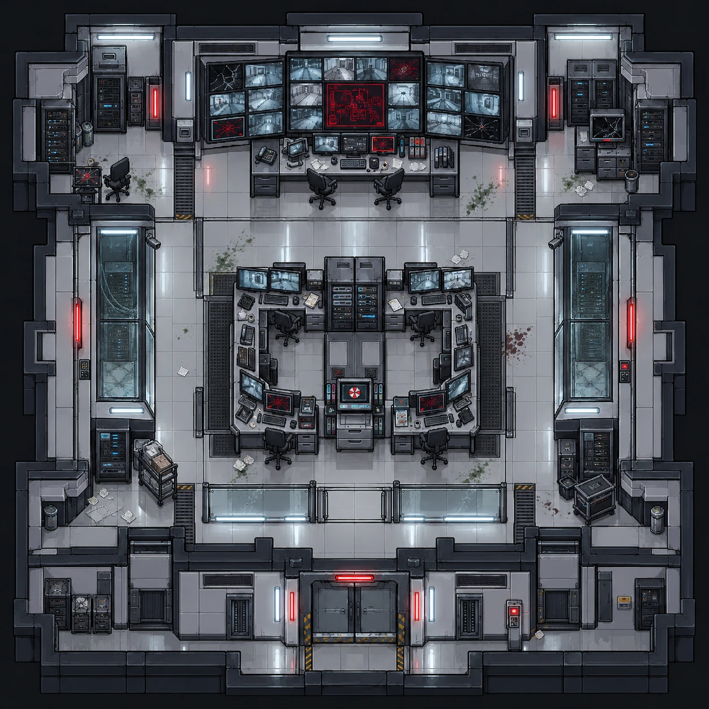

# Central de segurança

| | |
|---|---|
| **Função no complexo** | Monitores, controles de acesso e registros de vigilância |
| **Papel no caso** | Registros de quem entrou e saiu; câmeras interrompidas; descarta a invasão externa |
| **Personagens ligados** | [Giovani Pistori](../../personagens/giovani-pistori/) (chefe de segurança), [Otávio Ferraz](../../personagens/otavio-ferraz/) (álibi conferido nos registros) |
| **Proposições** | W, T (≡ ¬A), O, I |

## O espaço

Sala quadrada com uma **única porta dupla, ao sul**. A parede norte inteira é ocupada pelo painel de vídeo, e não há porta desse lado.

- **Painel de vídeo (norte):** dezenas de telas com imagens das câmeras dos corredores. Várias estão **rachadas ou com estática vermelha**. No centro, uma tela grande mostra a **planta do complexo em vermelho**.
- **Mesa de operação:** fica abaixo do painel, com duas cadeiras, telefone, monitores menores e papéis.
- **Ilha central:** duas estações em L, de frente uma para a outra, com **quatro postos de operação** cheios de monitores de câmeras. Entre elas há um rack e um terminal central.
- **Barreira de vidro:** um guarda-corpo separa a ilha da área de entrada.
- **Laterais:** racks altos fechados em vidro e **câmeras de vigilância** presas às paredes, nos dois lados.
- **Cantos:**
  - racks, arquivos e cadeiras (noroeste);
  - um monitor quebrado e gaveteiros (nordeste).
- **Entrada (sul):** leitor de crachá ao lado da porta, armários e painéis elétricos nos nichos.
- **Sinais de colapso:** gotas de sangue a leste, papéis espalhados, um carrinho com caixa e um baú de equipamento.

**Leitura visual:** a vigilância foi cortada. Algumas câmeras ainda transmitem, outras pararam, o que bate com a interrupção do monitoramento descrita no caso.

## O que se descobre aqui

| Evidência | Proposição | Fonte no caso |
|---|---|---|
| **Relatório de acesso:** horários, setores visitados e tentativas de entrada; mostra que Otávio saiu antes da liberação | W | Premissa 8 |
| O relatório só é compatível com quatro hipóteses: Fernando, Otávio, Beatrice ou invasão | Y ∨ O ∨ B ∨ I | Premissa 10 |
| **Crachá de acesso:** quem entrou nos setores restritos e quando | — | Item 1 |
| Depoimento de Giovani: não houve arrombamento | T (≡ ¬A) | Premissa 5 |

## Na prova

- **Otávio:** com W e O → ¬W, Dupla Negação e Modus Tollens dão **¬O**.
- **Invasão:** com ¬A e I → A, Modus Tollens dá **¬I**.
- **Resultado:** os dois descartes alimentam ¬(O ∨ B ∨ I), que leva a Y.
