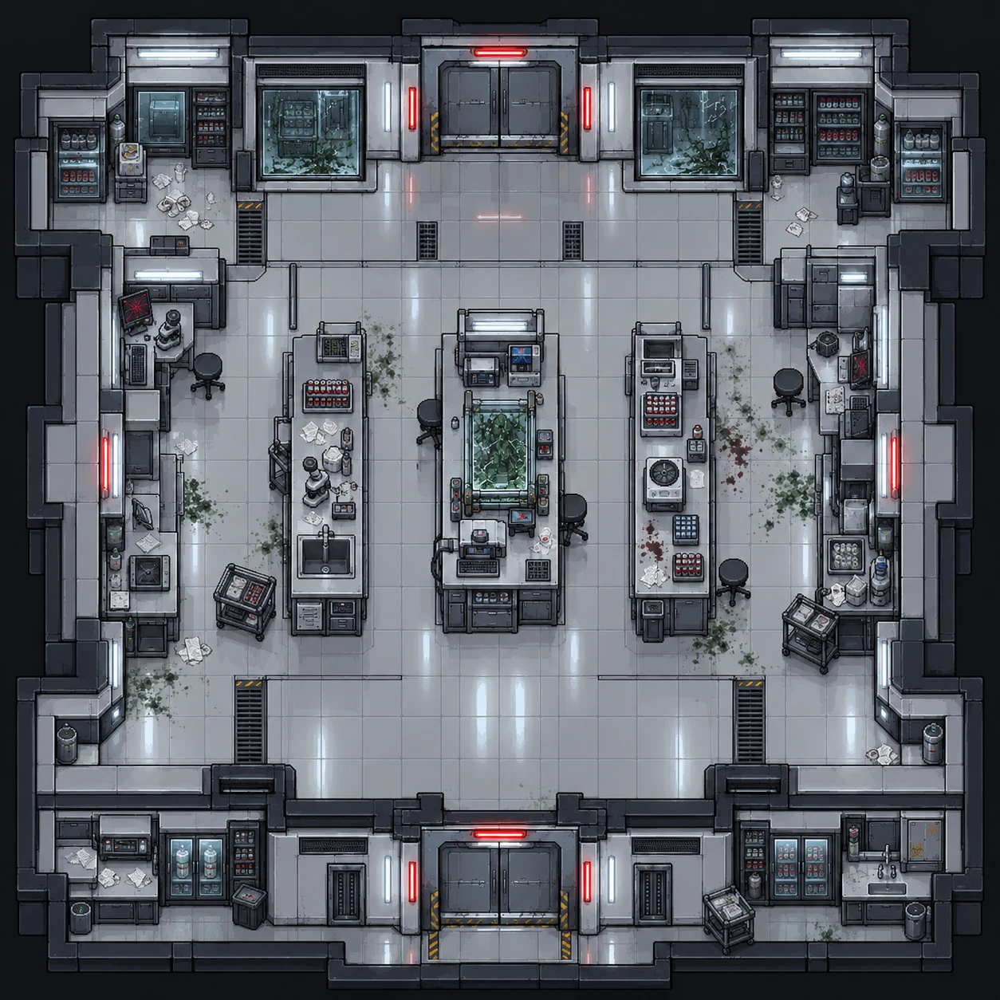

# Laboratório de análises

| | |
|---|---|
| **Função no complexo** | Setor em que os pesquisadores estudavam a amostra e realizavam experimentos |
| **Papel no caso** | Contexto científico: o experimento que a direção quis antecipar |
| **Personagens ligados** | [Amie Lin](../../personagens/amie-lin/) (virologista), [Fernando Almeida](../../personagens/fernando-almeida/) (aprovação dos experimentos), [Otávio Ferraz](../../personagens/otavio-ferraz/) (estagiário de pesquisa) |
| **Proposições** | P, Q |

## O espaço

Laboratório amplo com portas duplas ao norte e ao sul, organizado em **três bancadas centrais** paralelas e bancadas de trabalho junto às paredes.

- **Bancada oeste:** suportes com tubos de ensaio de amostras vermelhas, microscópio, pia, frascos e papéis de anotação.
- **Bancada central:** uma **cuba de vidro com crescimento orgânico verde**, monitor, instrumentos de medição e teclado. É o ponto focal da sala.
- **Bancada leste:** equipamento de análise do tipo centrífuga, suportes de amostras e um teclado numérico. Há **manchas de sangue** no piso ao lado.
- **Parede norte:** janelas de observação rachadas, com vegetação verde atrás.
- **Laterais:**
  - estações com microscópios, monitores de tela vermelha e banquetas;
  - geladeiras e armários com frascos de amostras;
  - carrinhos com equipamentos e documentos.
- **Sul:** geladeiras de amostras, pia, armário com símbolo de risco biológico, lixeiras e carrinho.
- **Contaminação:** focos verdes espalhados entre as bancadas, mais concentrados no lado leste.

**Leitura visual:** a pesquisa foi interrompida no meio. Os tubos continuam nos suportes, as anotações ficaram sobre as bancadas e a cultura ainda está na cuba.

## O que se descobre aqui

| Evidência | Proposição | Fonte no caso |
|---|---|---|
| Alerta científico de Amie sobre o risco de acelerar o experimento | P | Premissa 1 (relatório científico) |
| Contexto da antecipação do experimento pedida pela direção | Q | Premissa 2 (gravador de áudio) |

> O caso não define em qual sala estão o relatório de Amie e o gravador de áudio. A ligação acima vem do tema do espaço e precisa ser confirmada.

## Na prova

P e Q fazem parte do antecedente da premissa 9, (Q ∧ R ∧ S ∧ P) → X: o experimento foi antecipado apesar do alerta.
