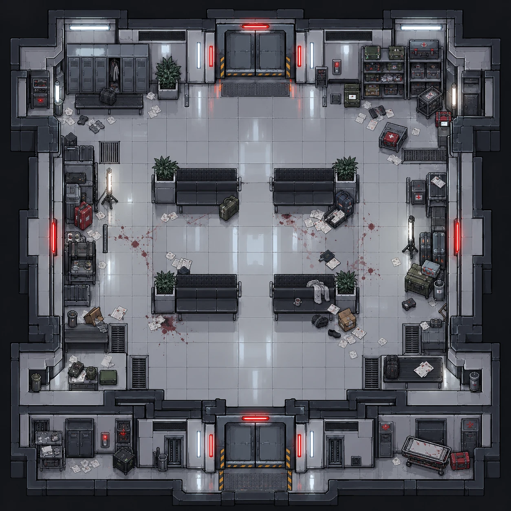

# Sala de evacuação

| | |
|---|---|
| **Função no complexo** | Ponto de reunião para evacuação; comunicados de emergência |
| **Papel no caso** | Documentos deixados pelos funcionários na fuga; a mensagem de emergência interrompida |
| **Personagens ligados** | Todos os sete funcionários, evacuados na noite do surto |
| **Proposições** | — (contexto e pistas de apoio) |

## O espaço

Sala ampla com portas duplas ao norte e ao sul e o centro aberto para circulação. É o mapa que mais transmite **fuga às pressas**.

- **Área de espera:** quatro bancos pretos acolchoados em dois pares, cada um com um vaso de planta ao lado.
- **Noroeste:** fileira de **armários de funcionários** com um jaleco pendurado, um banco e uma bolsa abandonada.
- **Nordeste:** estantes de **suprimentos**, como caixas, kits de primeiros socorros e maletas médicas, além de um carrinho e uma caixa de primeiros socorros no chão.
- **Laterais:** **malas e bagagens** deixadas para trás (uma vermelha a oeste), caixas de equipamento e **refletores portáteis** em tripés, montados para a evacuação.
- **Sul:**
  - um carrinho com papéis e um armário (sudoeste);
  - uma **maca manchada de sangue** e uma maleta médica vermelha (sudeste).
- **Sinais de fuga:**
  - documentos espalhados por todo o piso;
  - **rastros de sangue** entre os bancos;
  - bolsas abertas, sapatos, um casaco largado sobre um banco e uma caneca esquecida.

**Leitura visual:** as pessoas saíram correndo e largaram tudo. O sangue e a maca indicam que houve feridos durante a evacuação.

## O que se descobre aqui

| Evidência | Proposição | Fonte no caso |
|---|---|---|
| Comunicados de emergência e documentos deixados pelos funcionários | — | Locais, item 6 |
| Mensagem de emergência interrompida | — | README (premissa da história) |

> O caso não liga nenhuma premissa da prova a esta sala. Ela funciona como ambientação e pode guardar pistas de apoio, que ainda precisam ser definidas.
