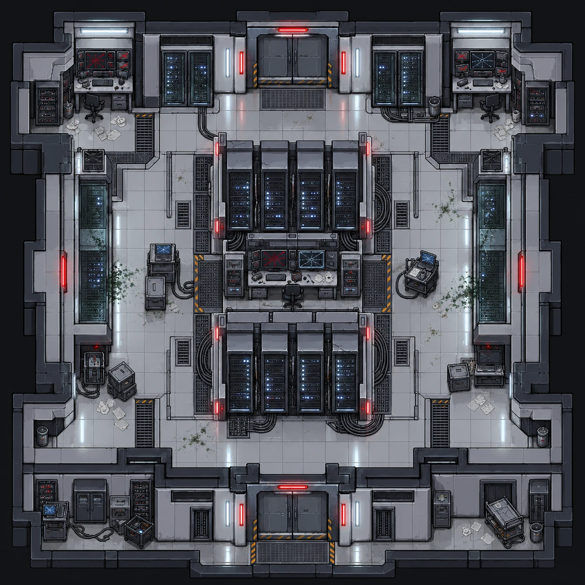
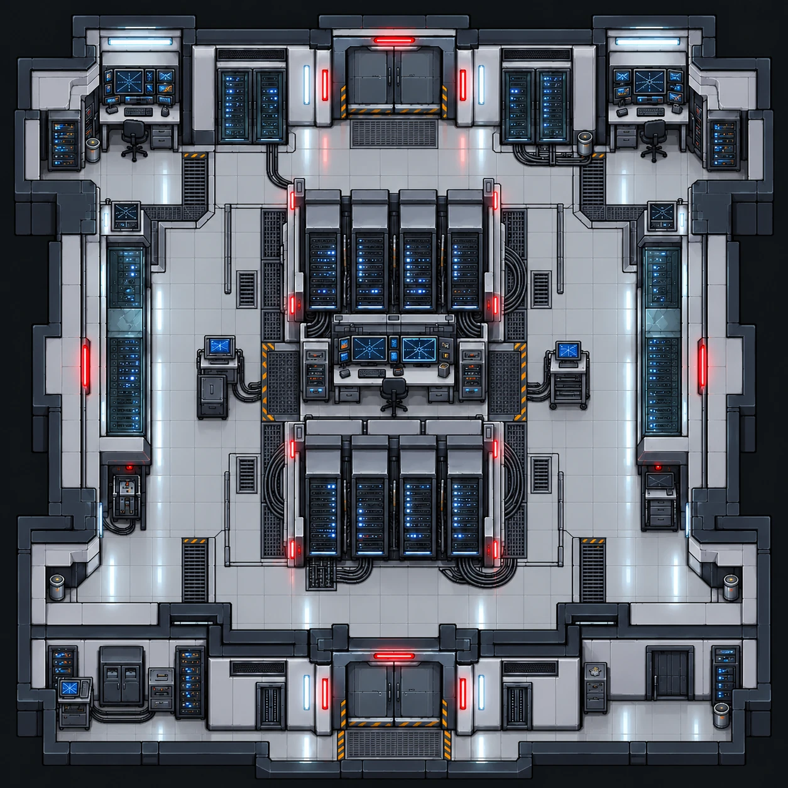

# Sala de servidores

| Pós-incidente | Versão limpa |
|---|---|
|  |  |

| | |
|---|---|
| **Função no complexo** | Armazenamento dos registros digitais e dos comandos executados |
| **Papel no caso** | Onde se descobre que a alteração da contenção foi autorizada por uma conta da direção |
| **Personagens ligados** | [Angela Torres](../../personagens/angela-torres/) (administração de sistemas e análise dos comandos) |
| **Proposições** | R, S, Z |

## O espaço

Sala quadrada com portas duplas ao norte e ao sul. As grelhas de ventilação no piso, logo na frente das duas portas, ligam visualmente este espaço à rede de dutos.

- **Centro:** um bloco de **oito racks de servidores** em duas fileiras de quatro, com LEDs azuis acesos, indicadores vermelhos nas laterais e feixes de cabos pelo chão.
- **Terminal central:** entre as duas fileiras há uma mesa de administração com dois monitores. Um mostra um **alerta vermelho** e o outro um **diagrama de rede azul**.
- **Parede norte:** armários de rack de cada lado da porta, com cabos descendo até o piso.
- **Cantos superiores:** duas estações de trabalho com vários monitores, a maioria com telas vermelhas de erro, além de racks menores e papéis espalhados.
- **Laterais:** racks altos fechados em vidro.
- **Terminais móveis:**
  - um carrinho com monitor e caixa, ligado por cabos (oeste);
  - um carrinho com notebook aberto (leste).
- **Sul:** caixas de equipamento, armários, um carrinho com cabos soltos e uma maca no nicho sudeste.
- **Contaminação:** pouca, só em pequenos focos verdes perto das laterais.

**Leitura visual:** o sistema continua parcialmente ligado. Os racks funcionam, mas os terminais exibem erros, o que combina com registros apagados ou alterados que ainda podem ser recuperados.

## O que se descobre aqui

| Evidência | Proposição | Fonte no caso |
|---|---|---|
| O sistema registrou uma autorização administrativa para alterar a contenção | R | Premissa 3 (registro do sistema) |
| O comando foi executado com uma conta da direção | S | Premissa 4 (análise de Angela) |
| **Pendrive criptografado:** cópia parcial dos registros do experimento e dados recuperados dos sistemas | Z | Premissa 14 → linha 29 |

## Na prova

R e S, junto com P e Q, satisfazem a premissa 9 e levam a **X** (a liberação foi autorizada pela direção). Por Modus Ponens (S → Z com S), conclui-se **Z**: o pendrive contém o registro decisivo.
