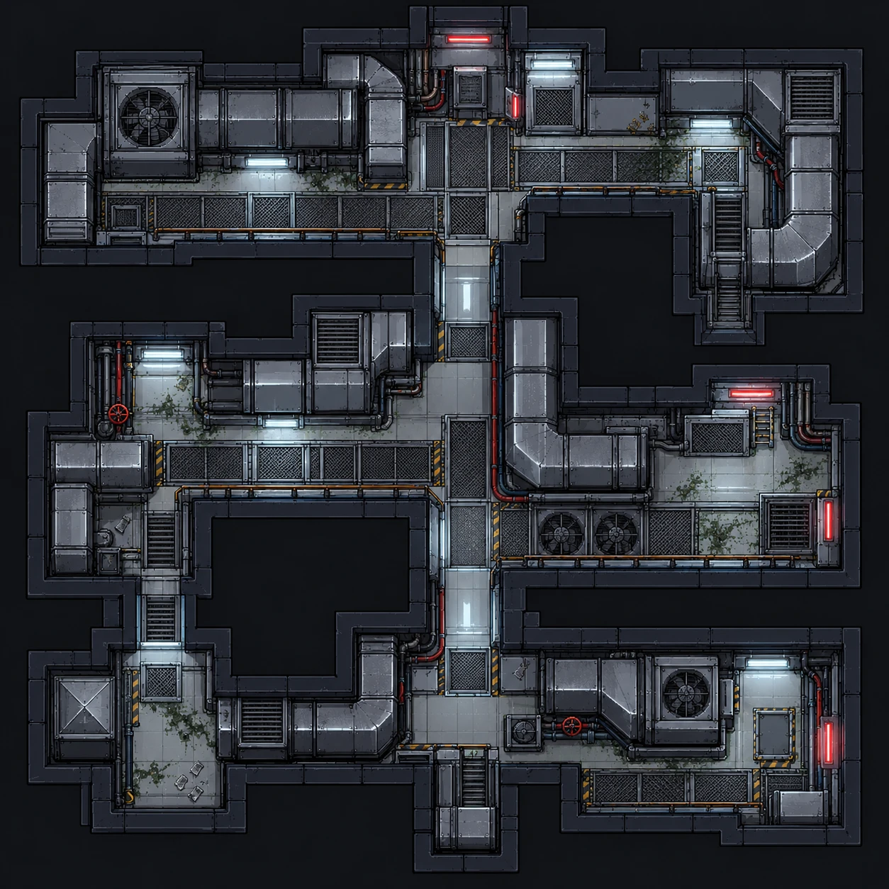
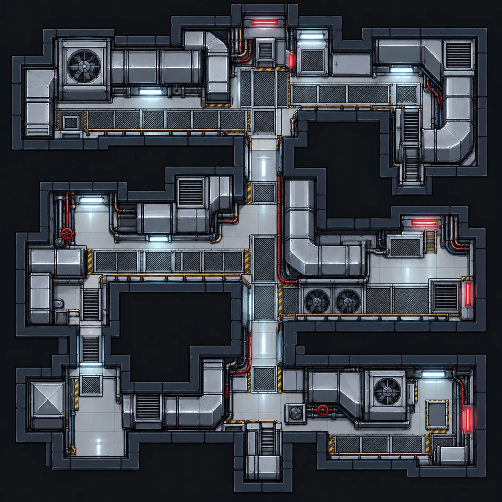

# Túnel de ventilação

| Pós-incidente | Versão limpa |
|---|---|
|  |  |

| | |
|---|---|
| **Função no complexo** | Estrutura que conecta os setores; acesso de manutenção |
| **Papel no caso** | Explica como o agente se espalhou; está ligado à ordem de manutenção suspeita |
| **Personagens ligados** | [Beatrice Salles](../../personagens/beatrice-salles/) (dutos, geradores e rotas de serviço) |
| **Proposições** | V, B |

## O espaço

Diferente das outras salas, o túnel não é um ambiente quadrado. É uma **rede de corredores estreitos** que se ramifica a partir de uma passarela central vertical.

- **Espinha central:** corredor de grade metálica que corta o mapa de cima a baixo, com luzes frias no teto e uma tubulação vermelha correndo pela lateral.
- **Ramais:** quatro braços principais (noroeste, oeste, leste e sudeste), cada um levando a uma área técnica.
- **Equipamentos:**
  - **dutos largos** de metal com curvas e emendas;
  - **exaustores industriais**: um grande a noroeste, dois a leste e um a sudeste;
  - grelhas e caixas de filtro;
  - **válvulas vermelhas** nas tubulações vermelha e azul.
- **Acessos verticais:** escadas e alçapões a nordeste, a oeste e na saída sul do corredor central, ligando o túnel aos outros setores.
- **Sinalização:** faixas amarelas e pretas nas passagens e luzes vermelhas de alerta nas extremidades leste.
- **Contaminação:** **focos verdes ao longo de quase todos os corredores**, mais do que em qualquer outro mapa. Há também detritos nos becos sem saída, como no canto sudoeste.

**Leitura visual:** o túnel funciona como o caminho da propagação, e a contaminação acompanha o traçado dos dutos.

## O que se descobre aqui

| Evidência | Proposição | Fonte no caso |
|---|---|---|
| A **ordem de manutenção** da ventilação tem inconsistências e não partiu de Beatrice | V | Premissa 7 (ordem de manutenção / depoimento de Beatrice) |

> O caso não define onde a ordem de manutenção é encontrada. Este túnel é o local mais coerente, mas isso precisa ser confirmado.

## Na prova

Com B → ¬V (premissa 12) e V, aplica-se Dupla Negação e Modus Tollens: **¬B**, ou seja, Beatrice não foi a responsável.
