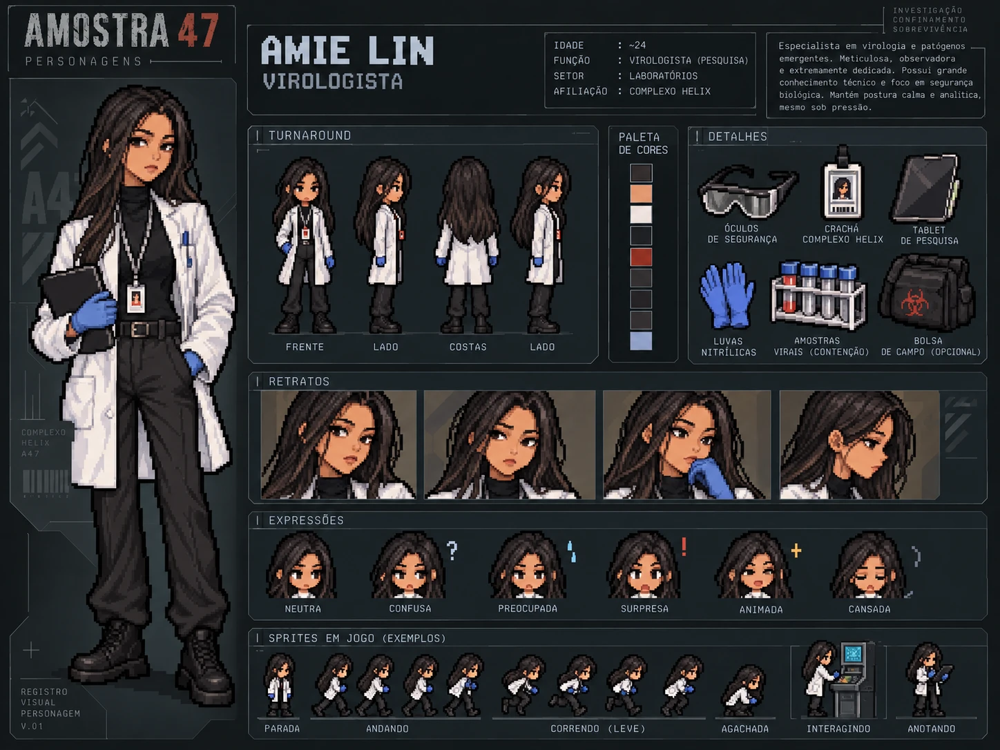

# Dra. Amie Lin — Virologista

| | |
|---|---|
| **Função** | Virologista, responsável pelo estudo da Amostra 47 |
| **Idade** | 24 anos |
| **Setor** | Laboratórios |
| **Papel na investigação** | Fonte de evidência: alerta científico |
| **Proposição** | P |

## A ciência acima de tudo

Criada em uma família tradicional de engenheiros, Amie Lin cresceu cercada por expectativas que nunca foram verdadeiramente suas. Desde pequena, seu futuro parecia decidido: seguiria os passos da família, ingressaria em uma universidade prestigiada e construiria uma carreira na engenharia. Entretanto, Amie sempre demonstrou um interesse muito maior pela biologia, especialmente pelo estudo dos vírus e de seu comportamento.

Sua decisão de seguir a carreira científica não foi bem recebida. Para sua família, abandonar uma tradição de gerações significava desperdiçar as oportunidades que lhe haviam sido oferecidas. Ainda assim, Amie não estava disposta a abrir mão de suas próprias ambições. Determinada a construir uma vida independente, deixou seu país de origem para estudar virologia no exterior, afastando-se da família e de tudo o que conhecia.

Os anos seguintes foram marcados por uma dedicação quase obsessiva aos estudos. Amie sabia que não poderia contar com a aprovação da família e, por isso, sentia que precisava provar constantemente seu valor. Sua disciplina e inteligência logo a destacaram entre os colegas, permitindo que concluísse sua formação e conquistasse reconhecimento na área.

Durante sua trajetória acadêmica, Amie desenvolveu uma profunda admiração pelo Complexo Helix, um renomado centro de pesquisas fundado por um pesquisador cuja reputação ultrapassava as descobertas feitas em seus laboratórios. Conhecido por sua integridade, humanidade e compromisso com a segurança científica, o fundador defendia que nenhum avanço justificava colocar vidas em risco. Sob sua liderança, o complexo tornou-se referência não apenas pela excelência das pesquisas, mas também pelo respeito dedicado aos profissionais que ali trabalhavam.

Para Amie, trabalhar no Helix significava fazer parte de algo maior: contribuir para descobertas importantes em um ambiente que, acreditava ela, compartilhava seus princípios.

Quando finalmente conseguiu ingressar no complexo, porém, o fundador já havia falecido. A direção estava nas mãos de seu filho, o Dr. Fernando Almeida.

No início, Amie acreditava que Fernando daria continuidade ao legado do pai. Sua competência rapidamente chamou a atenção da administração e, em pouco tempo, ela conquistou posições de maior responsabilidade no laboratório. Seu conhecimento em virologia acabou levando-a a trabalhar diretamente com Fernando em um dos projetos mais sigilosos do complexo: a Amostra 47.

O material estudado apresentava características extremamente instáveis e um potencial de contaminação alarmante. Amie sabia que qualquer descuido poderia provocar consequências irreversíveis. Por isso, insistia em testes rigorosos, na documentação adequada dos resultados e no cumprimento integral dos protocolos de biossegurança.

Fernando, entretanto, tinha outras prioridades.

Diferentemente do pai, o novo diretor enxergava as pesquisas principalmente como oportunidades comerciais. Pressionado pela possibilidade de contratos milionários e pelo prestígio que uma descoberta revolucionária poderia trazer, passou a exigir resultados cada vez mais rápidos. Etapas de segurança eram encurtadas, dados inconvenientes eram omitidos e procedimentos essenciais passaram a ser tratados como obstáculos burocráticos.

Amie começou a questionar abertamente essas decisões. A princípio, acreditava que poderia convencer Fernando a reconsiderar por meio de argumentos científicos. Contudo, quanto mais insistia, mais percebia que os riscos não eram fruto de ignorância, mas de escolhas deliberadas.

A relação entre os dois se deteriorou progressivamente. Fernando considerava a cautela de Amie um impedimento ao progresso do projeto, enquanto ela via nas atitudes do diretor uma ameaça crescente à segurança de todos.

Temendo que suas advertências fossem ignoradas ou que os registros oficiais fossem alterados, Amie passou a usar um pequeno **gravador pessoal** para documentar suas preocupações. Nele, registrava inconsistências nos experimentos, ordens questionáveis e suas próprias reflexões sobre o rumo que a pesquisa estava tomando. As gravações, feitas no início como uma forma de preservar a verdade, tornaram-se cada vez mais frequentes e angustiadas.

Amie já não reconhecia o instituto que um dia tanto admirara. O lugar que deveria representar o compromisso da ciência com a humanidade havia se transformado em um ambiente dominado pela ambição e pelo silêncio.

Apesar disso, ela permaneceu no projeto. Parte dela ainda acreditava que poderia impedir uma tragédia se continuasse acompanhando os experimentos de perto. Abandonar a pesquisa significaria deixar a Amostra 47 inteiramente nas mãos de Fernando.

Foi essa decisão que a manteve no Complexo Helix até a liberação da Amostra 47. E, quando os protocolos que tanto defendera finalmente foram violados, Amie percebeu que todos os seus alertas haviam sido em vão. O desastre que ela temia estava prestes a se tornar realidade.

## História

Amie era a cientista que mais conhecia a Amostra 47. Responsável pelo estudo do agente, tinha autorização para entrar na câmara de contenção e sabia exatamente o que aconteceria se algo saísse do controle.

Quando a direção passou a pressionar para antecipar o experimento, Amie registrou um **alerta científico** sobre os riscos de acelerar os testes. Esse relatório sobreviveu ao incidente e é uma das primeiras peças que Giulia encontra: prova que o perigo era conhecido e que alguém decidiu seguir em frente mesmo assim.

Trabalhar diretamente com a amostra não a torna suspeita. Nos registros do horário da liberação, Amie aparece em outro setor, e seu papel no caso é o de quem avisou.

## Destino

Quando o alarme soou, Amie não correu para as portas como os outros. Voltou ao Laboratório de análises para buscar máscaras para os colegas e morreu lá, tentando alcançá-las.

**Item pessoal:** [bolsa de campo](../../itens/pessoais/bolsa-de-campo/), encontrada no Laboratório de análises. É o primeiro item pessoal: Giulia precisa abri-la para encontrar o gravador.

## Na investigação

- **Ato I:** aparece entre os sete funcionários listados no terminal recuperado.
- **Ato II:** seu relatório científico confirma que houve alerta antes do experimento.
- **Ato III:** o alerta compõe, junto com Q, R e S, a cadeia que mostra que a liberação foi autorizada pela direção.

## Na prova lógica

| Onde | Expressão | Significado |
|---|---|---|
| Premissa 1 | P | Amie Lin alertou sobre o risco de acelerar o experimento. |
| Premissa 9 | (Q ∧ R ∧ S ∧ P) → X | O alerta, ignorado, faz parte do antecedente que leva a X. |
| Linhas 16–18 | P ∧ Q ∧ R ∧ S ⊢ X | Por Conjunção, Comutação e Modus Ponens. |

## Identidade visual

1. Cabelo longo, muito escuro, e expressão serena e analítica.
2. Jaleco off-white sobre gola alta preta, calça escura e botas pretas.
3. Crachá, tablet/prancheta e luvas nitrílicas azul-acinzentadas.

Nacionalidade tailandesa, definida pela criadora do projeto, retratada sem caricatura.

## Arquivos

| Arquivo | Conteúdo |
|---|---|
| [`ficha-visual.md`](ficha-visual.md) | Especificação visual completa: aparência, paleta, regras de pixel art, prompts e critérios de aprovação |
| [`ficha-card.webp`](ficha-card.webp) | Card de personagem: turnaround, paleta, acessórios, retratos, expressões e sprites de exemplo |

> A idade de 24 anos mostrada no card é a oficial.
