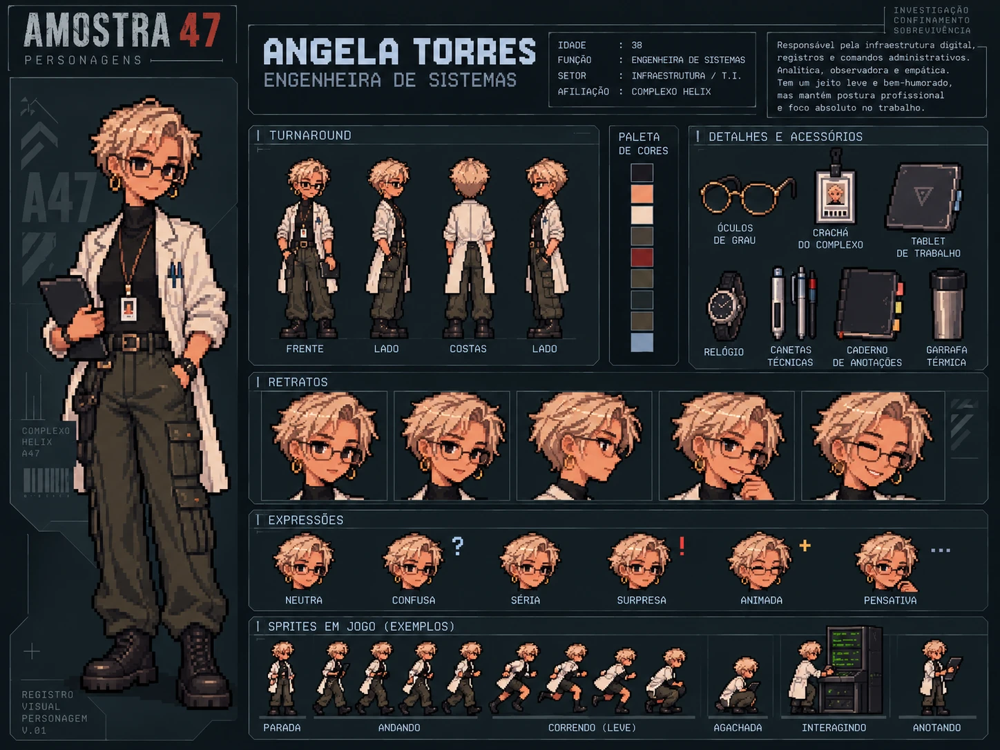

# Angela Torres — Engenheira de sistemas

| | |
|---|---|
| **Função** | Engenheira de sistemas |
| **Setor** | Infraestrutura / T.I. (Sala de servidores) |
| **Papel na investigação** | Fonte de evidência: registros digitais e comandos administrativos |
| **Proposição** | S |

## História

Angela administrava os terminais, os registros digitais e as permissões do Complexo Helix. Se algum comando passou pelo sistema, ela é quem sabe rastreá-lo.

Depois do incidente, registros foram apagados e alterados. Ter acesso técnico a tudo isso poderia torná-la suspeita, mas acesso não é autoria. Foi a análise de Angela que revelou o detalhe mais importante do caso: o comando que alterou a contenção foi executado **com uma conta da direção**. Esse registro está no **pendrive criptografado de Angela**, que também guarda evidências de que a diretoria manipulou informações do sistema, como o aval da ordem de manutenção.

Na noite do incidente, ao perceber que a diretoria estava manipulando o sistema, Angela tentou mandar um alerta para **Giovani Pistori**, com quem trabalhava lado a lado e a única pessoa em quem confiava fora da direção. O envio foi interrompido quando o complexo foi trancado, e a mensagem chegou truncada ao computador da casa de Giovani, que já tinha saído às pressas para o complexo. Anos depois, é essa mensagem que leva Giulia, filha de Giovani, ao Complexo Helix.

Angela é o contraponto solar do elenco: acessível, bem-humorada e calorosa, sem perder a autoridade técnica nem o rigor profissional. Nos registros do horário da liberação, ela aparece em outro setor.

## Destino

Angela morreu na noite do incidente, junto com os demais funcionários. O complexo estava trancado, e ela ficou perto de uma das portas, tentando fugir.

**Item pessoal:** [caderno de anotações](../../itens/pessoais/caderno-de-simbolos/), **obrigatório**. Funciona como um dicionário dos símbolos das operações lógicas (~, ∨, ∧, →, ↔).

## Na investigação

- **Ato I:** aparece entre os sete funcionários listados no terminal recuperado.
- **Ato II:** na Sala de servidores, sua análise mostra a origem do comando administrativo.
- **Ato III:** sua descoberta liga a liberação à direção e aponta o pendrive como prova decisiva.

## Na prova lógica

| Onde | Expressão | Significado |
|---|---|---|
| Premissa 4 | S | O comando foi executado com uma conta da direção. |
| Premissa 9 | (Q ∧ R ∧ S ∧ P) → X | S é parte do antecedente que leva a X. |
| Premissa 14 | S → Z | O uso da conta da direção está registrado no pendrive. |
| Linha 29 | Z | Modus Ponens (14, 4): o pendrive contém o registro decisivo. |

## Identidade visual

1. Pixie curto loiro-acinzentado e sorriso caloroso.
2. Silhueta alta e magra, com jaleco aberto sobre gola alta preta.
3. Óculos leves, argolas douradas, tablet e calça cargo verde-oliva.

## Arquivos

| Arquivo | Conteúdo |
|---|---|
| [`ficha-visual.md`](ficha-visual.md) | Especificação visual completa: aparência, paleta, regras de pixel art, prompts e critérios de aprovação |
| [`ficha-card.webp`](ficha-card.webp) | Card de personagem: turnaround, paleta, acessórios, retratos, expressões e sprites de exemplo |

> A idade mostrada no card é ilustrativa; o que está definido é apenas que Angela é mais velha que as jovens pesquisadoras.
