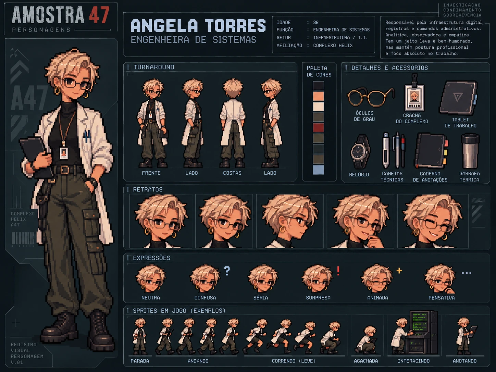

# Angela Torres — Engenheira de sistemas

| | |
|---|---|
| **Função** | Engenheira de sistemas |
| **Setor** | Infraestrutura / T.I. (Sala de servidores) |
| **Papel na investigação** | Fonte de evidência: registros digitais e comandos administrativos |
| **Proposição** | S |

## A lógica não mente

Angela Torres sempre gostou de coisas que fazem sentido. Filha de uma professora de matemática, cresceu numa casa cheia de cadernos, quebra-cabeças e problemas escritos na porta da geladeira. Enquanto outras crianças decoravam respostas, ela queria saber *por que* uma coisa levava a outra. Aprendeu cedo que um raciocínio bem montado não depende de opinião: se as premissas são verdadeiras e as regras são seguidas, a conclusão é inevitável.

Essa paixão a levou à computação. Na faculdade, Angela se apaixonou pela lógica por trás dos sistemas: circuitos, algoritmos, registros que guardam exatamente o que aconteceu, sem esquecer e sem mentir. Para ela, um log bem feito era a forma mais honesta de memória que existe. Formou-se em engenharia de sistemas e passou alguns anos em empresas grandes, onde aprendeu muito, mas sentia falta de trabalhar em algo que importasse.

Chegou ao **Complexo Helix** já mais experiente, ainda na época do Dr. Francisco Almeida, contratada para modernizar os terminais, os registros digitais e as permissões do complexo. Foi ela quem montou boa parte do sistema que, anos depois, guardaria as provas do incidente. Francisco gostava de dizer que Angela era "a memória do Helix".

Apesar do trabalho técnico, Angela era o lado solar da equipe. Bem-humorada, calorosa e sempre com uma garrafa térmica de café por perto, era quem animava os turnos longos e quem explicava os problemas do sistema com paciência para quem não entendia nada de computador. Carregava sempre um **caderno de anotações** de capa preta, com abas coloridas, onde rabiscava ideias, diagramas e, na primeira página, uma lista dos **símbolos lógicos** que ela usava para organizar o raciocínio: negação, conjunção, disjunção, implicação e bicondicional.

No Helix, Angela formou com **Giovani Pistori** uma dupla inseparável. Ele cuidava das portas e das câmeras; ela, dos sistemas e dos registros. Juntos, sabiam praticamente tudo o que acontecia no complexo. Viraram amigos de verdade. Angela conheceu Giulia ainda criança e, nas vezes em que a menina passou pelo complexo, mostrou a ela o caderno de símbolos, ensinando que *"se isto, então aquilo"* podia ser escrito com uma setinha.

Quando Fernando assumiu, Angela foi uma das primeiras a perceber que algo estava errado, porque os registros não mentem. Começaram a aparecer acessos fora de hora, permissões alteradas sem pedido formal e comandos executados com a **conta da direção** em horários em que ninguém deveria estar trabalhando. Quando ela levantava o assunto, recebia respostas vagas ou era lembrada, com um sorriso, de que aquilo "não era da conta dela".

Angela não confiava mais na direção, mas também não tinha provas suficientes para acusar ninguém. Então fez o que sabia fazer: guardou tudo. Copiou os registros suspeitos para um **pendrive criptografado** que levava sempre consigo, incluindo as evidências de que a diretoria tinha manipulado o aval de Beatrice na ordem de manutenção. Era a sua forma de garantir que, se algum dia alguém apagasse os logs do sistema, a verdade ainda existiria em algum lugar. Anos depois, esse pendrive se torna a prova capaz de desmentir a versão oficial e limpar o nome de Giovani.

## A família do Helix

Para Angela, a equipe do Helix era uma família, e Giulia era a sobrinha que ela escolheu. Sempre que Giovani precisava levar a filha para o complexo, Angela dividia com ela o chocolate quente da garrafa térmica e abria o caderno de símbolos para ensinar as setinhas. Foi Angela quem organizou a festinha surpresa de sete anos de Giulia, e está na foto de todos juntos.

## História

Angela administrava os terminais, os registros digitais e as permissões do Complexo Helix. Se algum comando passou pelo sistema, ela é quem sabe rastreá-lo.

Depois do incidente, registros foram apagados e alterados. Ter acesso técnico a tudo isso poderia torná-la suspeita, mas acesso não é autoria. Foi a análise de Angela que revelou o detalhe mais importante do caso: o comando que alterou a contenção foi executado **com uma conta da direção**. Esse registro está no **pendrive criptografado de Angela**, que também guarda evidências de que a diretoria manipulou informações do sistema, como o aval da ordem de manutenção.

Na noite do incidente, ao perceber que a diretoria estava manipulando o sistema, Angela tentou mandar um alerta para **Giovani Pistori**, com quem trabalhava lado a lado e a única pessoa em quem confiava fora da direção. No meio do envio, a direção derrubou a rede interna, e a mensagem chegou truncada ao notebook da casa de Giovani, quatro minutos depois de ele sair às pressas para o complexo. Anos depois, é essa mensagem que leva Giulia, filha de Giovani, ao Complexo Helix.

Angela é o contraponto solar do elenco: acessível, bem-humorada e calorosa, sem perder a autoridade técnica nem o rigor profissional. Nos registros do horário da liberação, ela aparece em outro setor.

## Destino

Angela morreu na noite do incidente, junto com os demais funcionários. O complexo estava trancado, e ela ficou perto de uma das portas, tentando fugir.

**Item pessoal:** [caderno de anotações](../../itens/pessoais/caderno-de-simbolos/), **obrigatório**. Funciona como um dicionário dos símbolos das operações lógicas (~, ∨, ∧, →, ↔).

## Na investigação

- **Ato I:** aparece entre os sete funcionários listados no terminal recuperado.
- **Ato II:** na Sala de servidores, sua análise mostra a origem do comando administrativo.
- **Ato III:** sua descoberta liga a liberação à direção e aponta o pendrive como prova decisiva.

## Na prova lógica

| Onde | Expressão | Significado |
|---|---|---|
| Premissa 4 | S | O comando foi executado com uma conta da direção. |
| Premissa 9 | (Q ∧ R ∧ S ∧ P) → X | S é parte do antecedente que leva a X. |
| Premissa 14 | S → Z | O uso da conta da direção está registrado no pendrive. |
| Linha 32 | Z | Modus Ponens (14, 4): o pendrive contém o registro decisivo. |

## Identidade visual

1. Pixie curto loiro-acinzentado e sorriso caloroso.
2. Silhueta alta e magra, com jaleco aberto sobre gola alta preta.
3. Óculos leves, argolas douradas, tablet e calça cargo verde-oliva.

## Arquivos

| Arquivo | Conteúdo |
|---|---|
| [`ficha-visual.md`](ficha-visual.md) | Especificação visual completa: aparência, paleta, regras de pixel art, prompts e critérios de aprovação |
| [`ficha-card.webp`](ficha-card.webp) | Card de personagem: turnaround, paleta, acessórios, retratos, expressões e sprites de exemplo |

> A idade mostrada no card é ilustrativa; o que está definido é apenas que Angela é mais velha que as jovens pesquisadoras.
