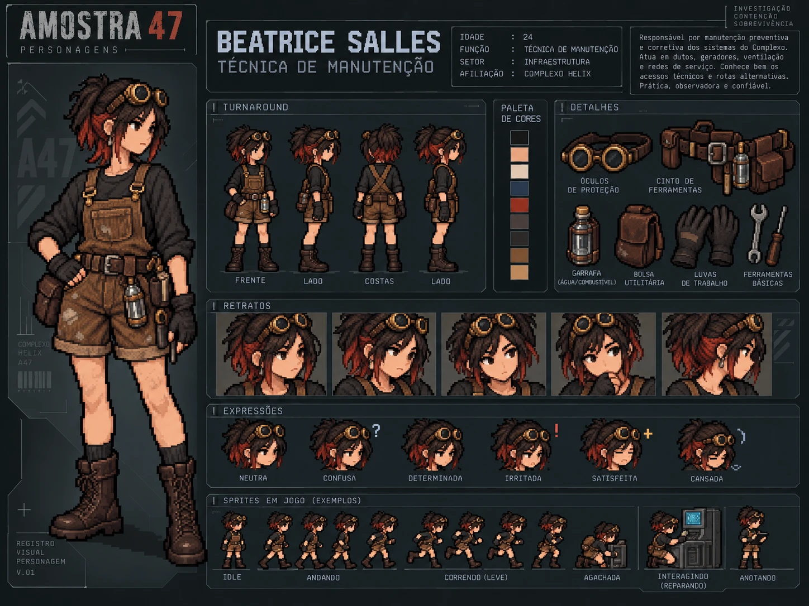

# Beatrice Salles — Técnica de manutenção

| | |
|---|---|
| **Função** | Técnica de manutenção |
| **Setor** | Infraestrutura (dutos, geradores, ventilação) |
| **Papel na investigação** | Suspeita descartada: a ordem de manutenção não partiu dela |
| **Proposições** | V, B |

## História

Beatrice conhecia o Complexo Helix por dentro: dutos de ventilação, geradores e rotas de serviço. Prática e observadora, sabia por onde passar quando os corredores principais estavam fechados.

Entre os documentos encontrados, há uma **ordem de manutenção da ventilação** com inconsistências, e o túnel de ventilação conecta os setores do complexo, o que poderia explicar como o agente se espalhou. Isso coloca Beatrice entre as quatro hipóteses compatíveis com o relatório de acesso.

A investigação mostra que **a ordem não partiu dela**. Se Beatrice fosse a responsável, a ordem teria saído dela. Como não saiu, ela está descartada, embora seu trabalho continue ligado a um sistema importante para entender a propagação.

## Na investigação

- **Ato I:** aparece entre os sete funcionários listados no terminal recuperado.
- **Ato II:** a ordem de manutenção e o depoimento de Beatrice mostram que a solicitação não foi dela.
- **Ato III:** é descartada por Modus Tollens.

## Na prova lógica

| Onde | Expressão | Significado |
|---|---|---|
| Premissa 7 | V | A ordem de manutenção da ventilação não partiu de Beatrice. |
| Premissa 12 | B → ¬V | Se fosse a responsável, a ordem teria partido dela. |
| Linha 22 | ¬(¬V) | Dupla Negação. |
| Linha 23 | ¬B | Modus Tollens (12, 22): Beatrice não foi a responsável. |

## Identidade visual

1. Goggles circulares de bronze sobre a cabeça.
2. Rabo de cavalo bagunçado, quase preto, com mechas inferiores vermelho-cobre.
3. Jardineira curta marrom, cinto de ferramentas e coturnos pesados.

O visual tem toques steampunk discretos, e a aparência dela não é evidência de culpa.

## Arquivos

| Arquivo | Conteúdo |
|---|---|
| [`ficha-visual.md`](ficha-visual.md) | Especificação visual completa: aparência, paleta, regras de pixel art, prompt e critérios de aprovação |
| [`ficha-card.webp`](ficha-card.webp) | Card de personagem: turnaround, paleta, acessórios, retratos, expressões e sprites de exemplo |

> A idade mostrada no card é ilustrativa; a ficha visual registra que a idade não foi definida no cânone.
