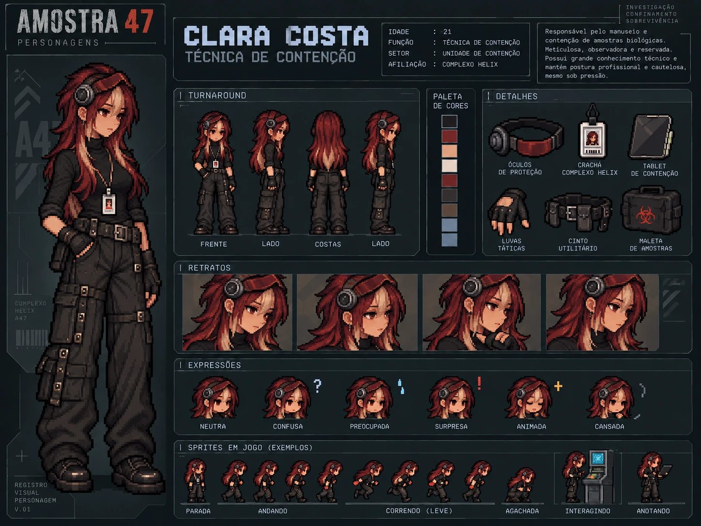

# Clara Costa — Técnica de contenção

| | |
|---|---|
| **Função** | Técnica de contenção |
| **Setor** | Unidade de contenção (Câmara de contenção) |
| **Papel na investigação** | Fonte de evidência: alteração dos parâmetros de contenção |
| **Proposição** | U |

## História

Clara era responsável pela inspeção dos equipamentos de segurança da contenção. Meticulosa e reservada, era a pessoa que perceberia primeiro se algo estivesse errado com a câmara.

E percebeu. Pouco antes da evacuação, Clara notou uma alteração na pressão da câmara e registrou uma **anomalia nos parâmetros de contenção**. O sensor de pressão recuperado no complexo confirma o registro. É essa evidência que localiza o início de tudo: a alteração manual aconteceu na **Câmara de contenção**.

Clara **detectou e documentou** a mudança; não há nada no caso que a coloque como autora. Nos registros do horário da liberação, ela aparece em outro setor.

## Na investigação

- **Ato I:** aparece entre os sete funcionários listados no terminal recuperado.
- **Ato II:** o sensor de pressão e o registro de Clara mostram que os parâmetros foram alterados manualmente.
- **Ato III:** sua evidência define o setor onde a propagação começou.

## Na prova lógica

| Onde | Expressão | Significado |
|---|---|---|
| Premissa 6 | U | Clara registrou a alteração manual dos parâmetros de contenção. |
| Premissa 15 | U → K | A alteração manual ocorreu na Câmara de contenção. |
| Linha 30 | K | Modus Ponens (15, 6): o setor foi a Câmara de contenção. |

## Identidade visual

1. Cabelo vermelho-vinho longo, com franja loiro-creme na frente.
2. Visor técnico âmbar-avermelhado e headset escuro na cabeça.
3. Roupa preta de gola alta, calça cargo larga, luvas sem dedos e botas de plataforma.

## Arquivos

| Arquivo | Conteúdo |
|---|---|
| [`ficha-visual.md`](ficha-visual.md) | Especificação visual completa: aparência, paleta, regras de pixel art, prompts e critérios de aprovação |
| [`ficha-card.webp`](ficha-card.webp) | Card de personagem: turnaround, paleta, acessórios, retratos, expressões e sprites de exemplo |

> A idade mostrada no card é ilustrativa e não faz parte do cânone do caso.
