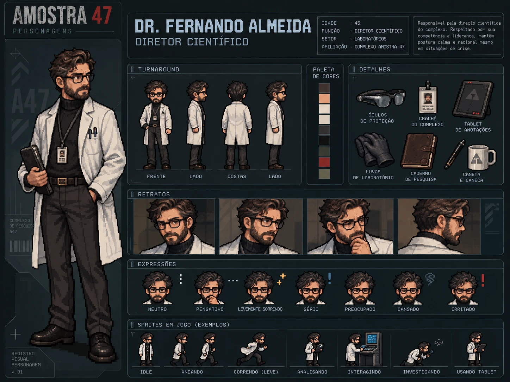

# Dr. Fernando Almeida — Diretor científico

> ⚠️ **Contém a solução do caso.**

| | |
|---|---|
| **Função** | Diretor científico |
| **Setor** | Laboratórios / direção |
| **Papel na investigação** | Responsável pela liberação da Amostra 47 |
| **Proposições** | Q, Y |

## História

Fernando aprovava os experimentos e supervisionava os protocolos de pesquisa do Complexo Helix. Respeitado, educado e de aparência gentil, é o tipo de chefe em quem a equipe confia.

Ele queria resultados para apresentar e pediu a **antecipação do experimento**, mesmo depois do alerta de Amie Lin sobre os riscos. O gravador de áudio registra essa conversa antes do alarme geral. Na sequência, o sistema registrou uma autorização administrativa para alterar a contenção, executada com uma conta da direção, e a alteração manual dos parâmetros aconteceu na Câmara de contenção.

À medida que as outras hipóteses caem (Otávio saiu antes, a ordem de manutenção não partiu de Beatrice e não houve invasão), resta apenas ele. **Fernando liberou a Amostra 47** por meio de uma autorização administrativa da direção, registrada no pendrive criptografado.

A aparência dele não deve entregar a culpa: o jogador precisa chegar à conclusão pela lógica.

## Na investigação

- **Ato I:** aparece entre os sete funcionários listados no terminal recuperado.
- **Ato II:** o gravador de áudio o associa à decisão de antecipar o experimento.
- **Ato III:** é a única hipótese que sobrevive ao cruzamento das pistas.

## Na prova lógica

| Onde | Expressão | Significado |
|---|---|---|
| Premissa 2 | Q | Fernando solicitou a antecipação do experimento. |
| Premissa 10 | Y ∨ O ∨ B ∨ I | Ele é uma das quatro hipóteses compatíveis com o relatório de acesso. |
| Linha 18 | X | A liberação foi autorizada pela direção. |
| Linha 26 | ¬(O ∨ B ∨ I) | As outras três hipóteses estão descartadas. |
| Linha 28 | Y | Silogismo Disjuntivo (27, 26): Fernando foi o responsável. |
| Linha 31 | X ∧ Y ∧ Z ∧ K | Conclusão final. |

## Identidade visual

1. Cabelo castanho penteado no estilo *old money* e barba bem aparada.
2. Expressão acolhedora, óculos discretos e postura levemente desajeitada.
3. Jaleco científico sobre gola alta escura, com barriga de chope moderada.

Nenhum sinal caricato de vilão.

## Arquivos

| Arquivo | Conteúdo |
|---|---|
| [`ficha-visual.md`](ficha-visual.md) | Especificação visual completa: aparência, paleta, regras de pixel art, prompts e critérios de aprovação |
| [`ficha-card.webp`](ficha-card.webp) | Card de personagem: turnaround, paleta, acessórios, retratos, expressões e sprites de exemplo |

> A idade mostrada no card é ilustrativa e não faz parte do cânone do caso. O card atual traz a afiliação "Complexo Amostra 47"; o nome do laboratório no caso é Complexo Helix.
