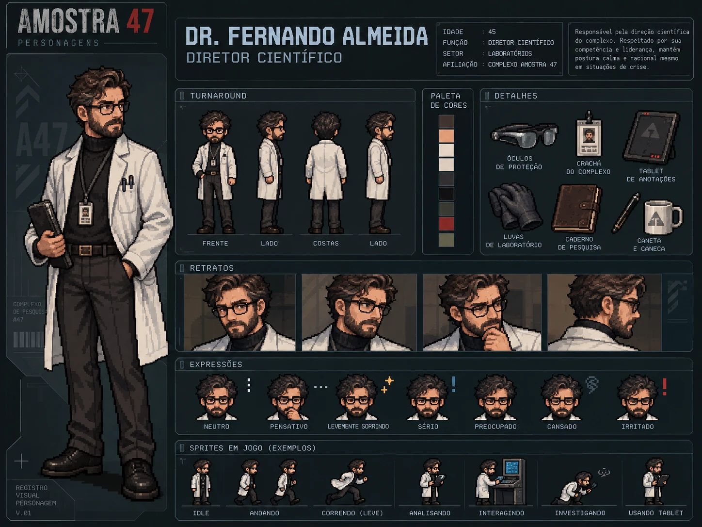

# Dr. Fernando Almeida — Diretor científico

> ⚠️ **Contém a solução do caso.**

| | |
|---|---|
| **Função** | Diretor científico |
| **Setor** | Laboratórios / direção |
| **Papel na investigação** | Responsável pela liberação da Amostra 47 |
| **Proposições** | Q, Y |

## À sombra do pai

Fernando Almeida cresceu dentro do Complexo Helix. Era filho do **Dr. Francisco Almeida**, fundador do complexo, um pesquisador admirado não só pelas descobertas, mas pela integridade. Francisco repetia que *"a ciência deve servir às pessoas"* e que nenhum avanço justificava colocar vidas em risco. Funcionários e colegas o tratavam quase como uma figura de família.

Para o filho, porém, Francisco era sobretudo uma sombra. Fernando passou a infância ouvindo elogios ao pai e comparações consigo mesmo. Estudou nas melhores instituições, formou-se cedo e voltou ao Helix com a certeza de que poderia fazer mais do que o pai tinha feito, e mais rápido. Francisco, cauteloso, segurava os projetos do filho, exigia mais testes e recusava atalhos. Fernando via nisso falta de visão, e não prudência.

A relação entre os dois esfriou. Fernando passou a enxergar o complexo como um negócio desperdiçado: pesquisas excelentes que nunca viravam dinheiro, contratos recusados por "questões éticas", anos de trabalho parados em protocolos. Para ele, o pai *"nunca entendeu o valor disso"*.

Quando Francisco morreu, Fernando herdou o Complexo Helix e a direção científica. No começo, manteve as aparências: fez discursos sobre continuar o legado do pai, sorria para a equipe e se mostrava um chefe educado, simpático e até um pouco desajeitado. Muitos acreditaram nele, inclusive pesquisadores que tinham entrado no Helix por admiração a Francisco, como **Amie Lin**.

Por trás da fachada, Fernando reorganizou tudo em torno do lucro. Fechou acordos com investidores como a **Asterion Biotec**, a **Kronos Labs** e a **Vértice**, prometeu resultados em prazos impossíveis e passou a cortar verbas e salários para mostrar números melhores. A equipe, que antes se sentia respeitada, passou a se sentir descartável. Em pouco tempo, o diretor gentil das reuniões se tornou, nos bastidores, um **tirano que só se importava com dinheiro**.

A **Amostra 47** virou a aposta da vida dele. Um agente instável e perigoso, mas com potencial comercial enorme. Fernando precisava apresentar resultados aos investidores em semanas, e cada etapa de segurança era um atraso. Mandou **antecipar o experimento**, riscou do cronograma o teste de contenção, a revisão da ventilação e a avaliação de risco ambiental, e passou a tratar os alertas de Amie como obstáculos.

Para isso, Fernando aprendeu a burlar o próprio sistema que o pai tinha construído. Usou a **conta da direção** para autorizar alterações na contenção, **manipulou o aval de Beatrice Salles** para emitir uma ordem de manutenção da ventilação em nome dela e mandou interromper o monitoramento quando não queria testemunhas. Anotava tudo num caderno pessoal, em frases curtas e meio cifradas, como quem sabe que está fazendo algo errado. Com o tempo, passou a ter medo de que alguém o encontrasse inteiro: arrancou as páginas mais comprometedoras e as escondeu em lugares diferentes do complexo, longe da sala da direção.

Fernando também nunca dava um passo sem um pé atrás. Para cada risco, tinha um plano B. E, para o caso de a Amostra 47 escapar, preparou o seu: **provas inventadas que apontariam outra pessoa como culpada**. O escolhido foi Giovani Pistori, o chefe de segurança, o homem que controlava as portas, as câmeras e os acessos, e portanto o suspeito mais fácil de vender ao mundo. As provas falsas ficaram guardadas numa cópia de segurança fora do complexo, prontas para serem encontradas.

Fernando nunca quis destruir o mundo. Queria resultados, dinheiro e provar que era maior que o pai. O vazamento da Amostra 47 não foi um plano: foi a consequência de cada etapa de segurança que ele pulou.

Enquanto o resto da equipe se tratava como família, Fernando ficava de fora. Achava "pouco profissional" que Giovani levasse a filha ao complexo e nunca aparecia quando todos se reuniam. Não está na foto da festinha de sete anos de Giulia: nunca fez parte daquela família.

Às vezes, a dúvida aparecia. No caderno, ele escreveu *"O que ele faria?"*, sobre o pai, e riscou em seguida. Embaixo da frase favorita de Francisco, *"Ciência deve servir às pessoas"*, escreveu *"Ainda acredito nisso?"*, e riscou também. Fernando não era um vilão de nascença: era alguém que escolheu, uma decisão de cada vez, deixar de ouvir a própria consciência.

## História

Como diretor científico, Fernando aprovava os experimentos e supervisionava os protocolos de pesquisa.

Ele queria resultados para apresentar e pediu a **antecipação do experimento**, mesmo depois do alerta de Amie Lin sobre os riscos. O gravador de áudio registra essa conversa antes do alarme geral. Na sequência, o sistema registrou uma autorização administrativa para alterar a contenção, executada com uma conta da direção, e a alteração manual dos parâmetros aconteceu na Câmara de contenção.

À medida que as outras hipóteses caem (Otávio saiu antes, a ordem de manutenção não partiu de Beatrice e não houve invasão), resta apenas ele. **Fernando liberou a Amostra 47** por meio de uma autorização administrativa da direção, registrada no pendrive criptografado.

Foi ele também quem emitiu a **ordem de manutenção da ventilação**: usou a autoridade da diretoria para manipular o aval de Beatrice Salles, de modo que a ordem parecesse vir dela. O pendrive criptografado de Angela guarda evidências de que Fernando manipulou essas informações.

A aparência dele não deve entregar a culpa: o jogador precisa chegar à conclusão pela lógica.

## Destino

Quando a amostra escapou, **Fernando trancou o complexo para calar todos os funcionários** que sabiam ou poderiam descobrir o que ele tinha feito. Ele ficou para trás para apagar os registros do sistema, contando sair por último. Não deu tempo: o agente chegou antes, e o bloqueio que ele mesmo tinha armado o prendeu lá dentro. Ninguém conseguiu fugir, e todos morreram, inclusive ele.

Mas o vírus já tinha saído pela ventilação e chegou ao mundo de qualquer forma, e milhões de pessoas morreram antes que uma cura fosse desenvolvida. Foi aí que o **plano B** funcionou: as provas que Fernando tinha inventado apontaram Giovani Pistori como o responsável pelo vazamento. O mundo encontrou o seu culpado, e o nome de Fernando nunca apareceu.

Enquanto os outros corriam para as portas, Fernando sabia que elas estavam trancadas. Morreu sozinho, isolado e longe de todos, sem terminar de apagar os rastros. Na última página do caderno, ficou a frase: *"Ninguém pode sair antes de eu apagar tudo."*

**Item pessoal:** [caderno com anotações suspeitas](../../itens/pessoais/caderno-do-fernando/), com as páginas arrancadas e escondidas pelo próprio Fernando em lugares diferentes do complexo.

## Na investigação

- **Ato I:** aparece entre os sete funcionários listados no terminal recuperado.
- **Ato II:** o gravador de áudio o associa à decisão de antecipar o experimento.
- **Ato III:** é a única hipótese que sobrevive ao cruzamento das pistas.

## Na prova lógica

| Onde | Expressão | Significado |
|---|---|---|
| Premissa 2 | Q | Fernando solicitou a antecipação do experimento. |
| Premissa 10 | Y ∨ G ∨ O ∨ B ∨ I | Ele é uma das cinco hipóteses compatíveis com o relatório de acesso e as provas divulgadas. |
| Linha 19 | X | A liberação foi autorizada pela direção. |
| Linha 29 | ¬(G ∨ O ∨ B ∨ I) | As outras quatro hipóteses estão descartadas. |
| Linha 31 | Y | Silogismo Disjuntivo (30, 29): Fernando foi o responsável. |
| Linha 34 | X ∧ Y ∧ Z ∧ K | Conclusão final. |

## Identidade visual

1. Cabelo castanho penteado no estilo *old money* e barba bem aparada.
2. Expressão acolhedora, óculos discretos e postura levemente desajeitada.
3. Jaleco científico sobre gola alta escura, com barriga de chope moderada.

Nenhum sinal caricato de vilão.

## Arquivos

| Arquivo | Conteúdo |
|---|---|
| [`ficha-visual.md`](ficha-visual.md) | Especificação visual completa: aparência, paleta, regras de pixel art, prompts e critérios de aprovação |
| [`ficha-card.webp`](ficha-card.webp) | Card de personagem: turnaround, paleta, acessórios, retratos, expressões e sprites de exemplo |

> A idade mostrada no card é ilustrativa e não faz parte do cânone do caso. O card atual traz a afiliação "Complexo Amostra 47"; o nome do laboratório no caso é Complexo Helix.
