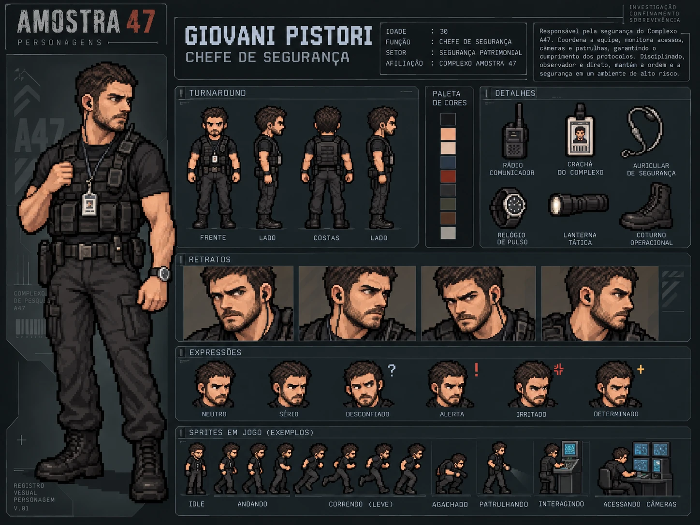

# Giovani Pistori — Chefe de segurança

| | |
|---|---|
| **Função** | Chefe de segurança do Complexo Helix |
| **Setor** | Segurança patrimonial (Central de segurança) |
| **Papel na investigação** | Fonte de evidência: acessos físicos e câmeras |
| **Proposição** | T (≡ ¬A) |

## Antes do Complexo Helix

Por anos, Giovani foi mochileiro e rodou o mundo sem endereço fixo. Essa vida acabou quando ele conheceu uma estrangeira e se apaixonou. Pouco tempo depois ela engravidou, e Giovani se tornou pai muito cedo.

O que parecia a vida dos sonhos virou pesadelo: a estrangeira sumiu sem deixar rastro e deixou Giovani sozinho com a filha recém-nascida, **Giulia**. Ela nunca mais voltou.

Desesperado e com medo de não conseguir sustentar a filha, Giovani fez um curso técnico de segurança e foi contratado pelo Complexo Helix. Com os anos de experiência, chegou a chefe do departamento de segurança. Para dar conta das jornadas longas, contava com uma vizinha idosa, que cuidava de Giulia sempre que ele trabalhava até tarde.

## História

Giovani controlava quem entrava e saía do Complexo Helix. Supervisionava as câmeras, os acessos físicos e os protocolos de segurança, e conhecia cada ponto cego da vigilância.

Na noite do incidente, Giovani estava em casa quando foi avisado de um problema no Complexo Helix. Deixou Giulia com a vizinha e saiu às pressas; essa imagem do pai saindo correndo é a última lembrança que Giulia tem dele.

No complexo, encontrou o monitoramento interrompido. Achou estranho, mas não ousou questionar a direção: o emprego era o que sustentava a filha, e ele não podia arriscar perdê-lo.

A interrupção das câmeras lança dúvidas sobre o próprio setor de segurança. Mas é justamente o registro de Giovani que esclarece um ponto decisivo: **a câmara de contenção não foi arrombada**. Sem arrombamento, a hipótese de uma invasão vinda de fora perde a sustentação, e a investigação passa a olhar para quem tinha credenciais internas.

Giovani é um profissional confiável, tenso e cansado, mas não um suspeito óbvio. Nos registros do horário da liberação, ele aparece em outro setor.

## Destino

Giovani morreu na noite do incidente, junto com os demais funcionários. Com o complexo trancado, ele foi até uma das portas e tentou destrancá-la pelo painel de segurança, sem saber que o bloqueio vinha da direção. Morreu ali, tentando abrir a saída para todos.

Anos depois, a filha, **Giulia**, vai ao Complexo Helix descobrir o que aconteceu com ele. Ela é a protagonista do jogo.

**Item pessoal:** o [crachá de identificação](../../itens/cracha-de-acesso/). De um lado, a foto de identificação; do outro, uma foto de Giovani com Giulia. Fica na Central de segurança e deve ser um dos primeiros itens encontrados.

## Na investigação

- **Ato I:** aparece entre os sete funcionários listados no terminal recuperado.
- **Ato II:** na Central de segurança, seus registros sobre acessos e câmeras separam uso de credencial interna de invasão.
- **Ato III:** a ausência de arrombamento descarta a invasão externa.

## Na prova lógica

| Onde | Expressão | Significado |
|---|---|---|
| Premissa 5 | T, ou seja, ¬A | Não houve arrombamento da câmara de contenção. |
| Premissa 13 | I → A | Uma invasão externa exigiria arrombamento. |
| Linha 19 | ¬A | Substituição por equivalência (T ≡ ¬A). |
| Linha 24 | ¬I | Modus Tollens (13, 19): não houve invasão externa. |

## Identidade visual

1. Cabelo castanho-escuro curto e barba curta aparada, com olhar de vigilância.
2. Ombros largos, camiseta preta e colete tático de segurança privada.
3. Crachá, rádio comunicador, auricular e coturnos escuros. Nenhuma arma.

## Arquivos

| Arquivo | Conteúdo |
|---|---|
| [`ficha-visual.md`](ficha-visual.md) | Especificação visual completa: aparência, paleta, regras de pixel art, prompts e critérios de aprovação |
| [`ficha-card.webp`](ficha-card.webp) | Card de personagem: turnaround, paleta, acessórios, retratos, expressões e sprites de exemplo |

> A idade mostrada no card é ilustrativa e não faz parte do cânone do caso. O card atual traz a afiliação "Complexo Amostra 47"; o nome do laboratório no caso é Complexo Helix.
