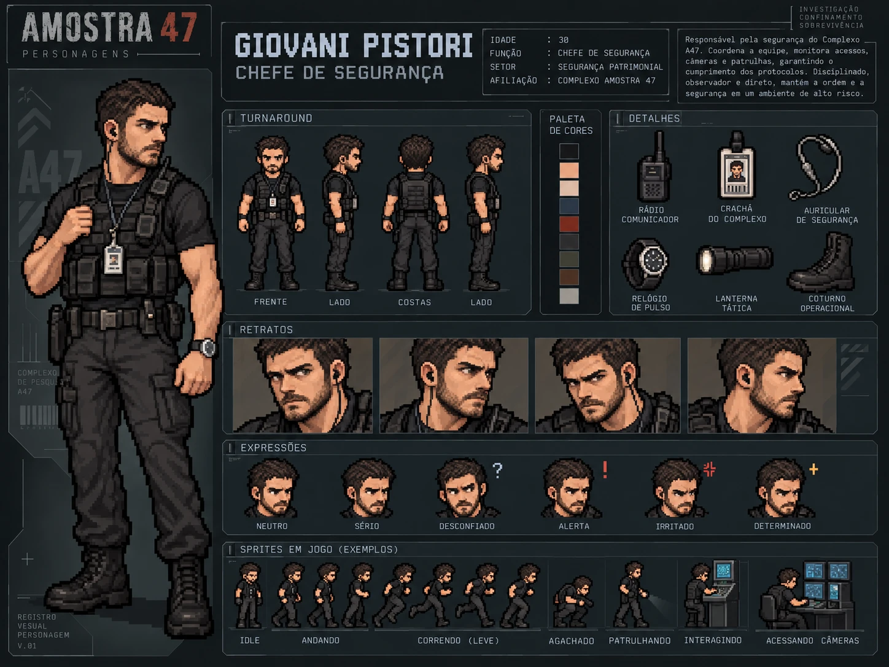

# Giovani Pistori — Chefe de segurança

| | |
|---|---|
| **Função** | Chefe de segurança do Complexo Helix |
| **Setor** | Segurança patrimonial (Central de segurança) |
| **Papel na investigação** | Fonte de evidência: acessos físicos e câmeras |
| **Proposições** | T (≡ ¬A), G |

## Tudo pela Giulia

Giovani Pistori nunca foi alguém de ficar parado. Saiu de casa cedo, com uma mochila nas costas e quase nenhum dinheiro, e passou anos rodando o mundo como mochileiro: dormia em albergues, trabalhava onde dava para pagar a próxima passagem e nunca ficava tempo suficiente num lugar para criar raízes. Era uma vida leve, sem horários e sem ninguém que dependesse dele.

Foi numa dessas viagens que conheceu uma estrangeira que mudou tudo. Ela era livre como ele, e por um tempo os dois viajaram juntos. Pela primeira vez, Giovani quis parar. Largou a estrada para ficar com ela e, pouco tempo depois, ela engravidou. Giovani ainda era muito jovem quando se descobriu pai.

A vida dos sonhos durou pouco. Logo depois do nascimento de **Giulia**, a estrangeira sumiu sem deixar rastro, sem explicação e sem endereço. Nunca mais voltou. Giovani ficou sozinho, sem formação, sem emprego fixo e com uma recém-nascida nos braços.

O medo de não conseguir sustentar a filha foi maior que qualquer outro. O rapaz que nunca tinha seguido uma regra entrou num **curso técnico de segurança** e descobriu, ali, que tinha talento para observar: percebia quem estava fora do lugar, decorava rotinas, enxergava pontos cegos. Conseguiu uma vaga no **Complexo Helix**, ainda na época do Dr. Francisco Almeida, um lugar onde o trabalho era duro, mas as pessoas eram tratadas com respeito.

Os anos seguintes foram de turnos longos e pouca vida própria. Para dar conta, Giovani contava com uma **vizinha idosa**, que cuidava de Giulia sempre que ele trabalhava até tarde. Ele chegava em casa de madrugada, passava pelo quarto da filha só para ver se ela estava dormindo e saía cedo de novo. O pouco tempo que tinham juntos era sagrado. A foto que ele guardava no verso do crachá, os dois abraçados, Giulia rindo de olhos fechados, era o motivo de todo o resto.

Com disciplina e experiência, Giovani virou **chefe do departamento de segurança**. Conhecia cada câmera, cada porta e cada ponto cego do complexo. Trabalhava lado a lado com **Angela Torres**, que cuidava dos sistemas: ela sabia o que passava pelos computadores, ele sabia quem passava pelas portas. Com o tempo, viraram amigos. Angela foi uma das poucas pessoas para quem Giovani falava da filha, e Giulia chegou a conhecê-la ainda criança.

Tudo mudou quando Francisco morreu e o filho, **Fernando Almeida**, assumiu o complexo. Vieram os cortes de verba e de salário, as ordens sem explicação e a pressão por resultados. Giovani via coisas que não gostava, como acessos fora de hora, pedidos estranhos da direção e protocolos encurtados, mas aprendeu a ficar quieto. Não era covardia: era a conta de luz, o aluguel e a escola da Giulia. Perder aquele emprego significava voltar a ter medo de não conseguir sustentar a filha.

Esse silêncio pesava. Giovani ficou mais tenso, mais cansado e mais calado. Continuava confiável e correto no trabalho, mas carregava a sensação de estar vendo algo errado acontecer sem poder fazer nada.

Na noite do incidente, Giovani estava em casa quando o **alarme automático de segurança** tocou no telefone dele: as câmeras do complexo tinham caído. Deixou Giulia com a vizinha, se abaixou para ajeitar os cachos dela e prometeu: *"Volto antes de você acordar."* Depois saiu correndo. A filha ficou na porta, olhando o pai ir embora às pressas. Foi a última vez que ela o viu.

## A família do Helix

Quando a vizinha não podia ficar com Giulia, Giovani não tinha com quem deixá-la e a levava para o complexo. Nunca precisou se preocupar: Angela, Beatrice, Clara, Amie e Otávio disputavam quem ia cuidar dela. Para Giovani, que nunca teve família por perto, aquela equipe virou exatamente isso. A foto da festinha de sete anos de Giulia, com todos juntos, ficava presa num dos armários da Sala de evacuação.

## História

Giovani controlava quem entrava e saía do Complexo Helix. Supervisionava as câmeras, os acessos físicos e os protocolos de segurança, e conhecia cada ponto cego da vigilância.

Ao chegar ao complexo naquela noite, encontrou o monitoramento interrompido. Achou estranho, mas não ousou questionar a direção: o emprego era o que sustentava a filha, e ele não podia arriscar perdê-lo.

A interrupção das câmeras lança dúvidas sobre o próprio setor de segurança. Mas é justamente o registro de Giovani que esclarece um ponto decisivo: **a câmara de contenção não foi arrombada**. Sem arrombamento, a hipótese de uma invasão vinda de fora perde a sustentação, e a investigação passa a olhar para quem tinha credenciais internas.

Giovani é um profissional confiável, tenso e cansado, mas não um suspeito óbvio. No relatório de acesso verdadeiro, guardado dentro do complexo, ele aparece em outro setor no horário da liberação, o oposto do que mostra o registro forjado que o mundo conheceu.

## Destino

Giovani morreu na noite do incidente, junto com os demais funcionários. Com o complexo trancado, ele foi até uma das portas e tentou destrancá-la pelo painel de segurança, sem saber que o bloqueio vinha da direção. Morreu ali, tentando abrir a saída para todos.

**Depois da morte:** quando o vírus chegou ao mundo e milhões morreram, o mundo precisou de um culpado, e as provas forjadas por Fernando entregaram um. Nos servidores do Helix estavam a ordem para desligar as câmeras com a credencial do chefe de segurança, um registro falso do crachá dele na Câmara de contenção minutos antes do alarme e mensagens inventadas sugerindo que ele tinha sido pago para facilitar uma entrada.

A foto do crachá estampou capas, telas e muros. A imprensa o chamou de **"o porteiro do fim do mundo"**. Os anos de mochileiro viraram "contatos suspeitos no exterior"; a estrangeira que foi embora virou "a cúmplice que fugiu". Surgiram grupos de ódio com o nome dele, e todos os anos, na data do surto, pessoas queimavam cartazes com o seu rosto. A casa onde ele criou a filha foi pichada com a palavra **ASSASSINO**.

Giovani não teve enterro. O corpo ficou lá dentro, do outro lado da porta que ele morreu tentando abrir. O homem que largou a estrada para não deixar faltar nada à filha virou, para o mundo inteiro, o homem que matou milhões, e a filha cresceu carregando esse nome numa cidade que nunca a deixou esquecer.

Quatorze anos depois, a filha, **Giulia**, vai ao Complexo Helix descobrir o que aconteceu com ele e limpar o nome do pai. Ela é a protagonista do jogo.

**Item pessoal:** o [crachá de identificação](../../itens/cracha-de-acesso/). De um lado, a foto de identificação; do outro, uma foto de Giovani com Giulia. Fica na Central de segurança e deve ser um dos primeiros itens encontrados.

## Na investigação

- **Ato I:** aparece entre os sete funcionários listados no terminal recuperado.
- **Ato II:** na Central de segurança, seus registros sobre acessos e câmeras separam uso de credencial interna de invasão.
- **Ato III:** a ausência de arrombamento descarta a invasão externa, e a conta da direção nos registros derruba as provas contra ele.

## Na prova lógica

| Onde | Expressão | Significado |
|---|---|---|
| Premissa 5 | T, ou seja, ¬A | Não houve arrombamento da câmara de contenção. |
| Premissa 13 | I → A | Uma invasão externa exigiria arrombamento. |
| Premissa 10 | Y ∨ G ∨ O ∨ B ∨ I | Ele é o culpado oficial e, por isso, uma das cinco hipóteses. |
| Premissa 16 | G → ¬S | Se fosse o responsável, os comandos não teriam saído da conta da direção. |
| Linha 20 | ¬A | Substituição por equivalência (T ≡ ¬A). |
| Linha 25 | ¬I | Modus Tollens (13, 20): não houve invasão externa. |
| Linha 27 | ¬G | Modus Tollens (16, 26): Giovani não foi o responsável. |

## Identidade visual

1. Cabelo castanho-escuro curto e barba curta aparada, com olhar de vigilância.
2. Muito alto, com mais de 1,90 m, ombros largos, camiseta preta e colete tático de segurança privada.
3. Crachá, rádio comunicador, auricular e coturnos escuros. Nenhuma arma.

## Arquivos

| Arquivo | Conteúdo |
|---|---|
| [`ficha-visual.md`](ficha-visual.md) | Especificação visual completa: aparência, paleta, regras de pixel art, prompts e critérios de aprovação |
| [`ficha-card.webp`](ficha-card.webp) | Card de personagem: turnaround, paleta, acessórios, retratos, expressões e sprites de exemplo |

> A idade mostrada no card é ilustrativa e não faz parte do cânone do caso. O card atual traz a afiliação "Complexo Amostra 47"; o nome do laboratório no caso é Complexo Helix.
