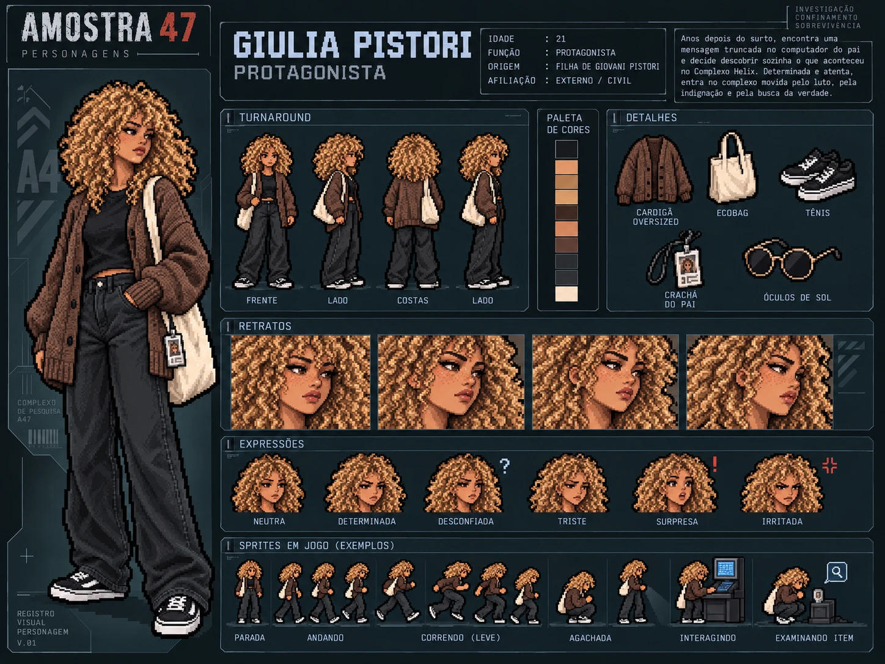

# Giulia Pistori — Protagonista

| | |
|---|---|
| **Papel no jogo** | Protagonista: é quem investiga o Complexo Helix |
| **Família** | Filha de [Giovani Pistori](../giovani-pistori/), chefe de segurança do complexo |
| **Idade** | 7 anos no incidente; 21 anos quando vai investigar o complexo |
| **Época** | Presente, 14 anos depois do surto |

## O que restou do pai

Giulia Pistori nasceu quando o pai, **Giovani**, ainda era muito jovem. A mãe, uma estrangeira que Giovani conheceu nos anos em que viajava como mochileiro, sumiu logo depois do parto e nunca mais voltou. Da mãe, Giulia herdou apenas o que via no espelho: os **cachos dourados** e as **sardas**. Do pai, herdou as sobrancelhas marcadas, o olhar atento e a teimosia.

Cresceu numa casa pequena, onde o pai era tudo. Giovani trabalhava em turnos longos no Complexo Helix, e quem ficava com ela era uma **vizinha idosa**, que a ensinou a cozinhar, a costurar botões e a esperar. Giulia aprendeu cedo a reconhecer o barulho da chave na porta de madrugada e a fingir que estava dormindo quando o pai passava pelo quarto para olhar se ela estava bem. Os poucos dias de folga dele eram os melhores da vida dela. Giovani, com mais de um metro e noventa, a carregava nos ombros, e lá de cima ela fazia uma pergunta atrás da outra. Eram uma dupla.

Quando a vizinha não podia, Giovani não tinha com quem deixá-la e a levava para o complexo. Para uma criança, aquilo era um castelo de vidro e metal, cheio de telas e corredores brilhantes, e cheio de gente que a adorava. A equipe do Helix se considerava uma família, e Giulia era a caçula de todos:

- **Angela Torres**, a melhor amiga do pai, dividia com ela o chocolate quente da garrafa térmica e mostrou que *"se isto, então aquilo"* podia ser escrito com uma setinha. Giulia passou semanas desenhando setas em tudo.
- **Beatrice Salles** consertava os brinquedos dela e montou para ela um cintinho de ferramentas de plástico.
- **Clara Costa** trançava os cachos dela e guardava lápis de cor na gaveta só para ela.
- **Amie Lin** mostrava a lupa e as lâminas coloridas nas áreas seguras do laboratório.
- **Otávio Ferraz** era quase um irmão mais velho: desenhava com ela e brincava de esconde-esconde nos corredores.

Só o diretor, **Fernando**, ficava de fora. Achava "pouco profissional" uma criança no complexo.

No aniversário de sete anos, poucos meses antes do incidente, a equipe fez uma festinha surpresa para ela no complexo. A sala estava fria, e o pai a enrolou no próprio cardigã marrom de lã. Alguém tirou uma foto de todos juntos, com Giulia no meio, quase sumindo dentro do casaco. Ela não guardou nenhuma lembrança desse dia. Anos depois, vai encontrar essa foto destruída no chão da Sala de evacuação.

Na noite do incidente, Giulia tinha **sete anos**. Um alarme automático de segurança tocou no telefone do pai; ele deixou a filha com a vizinha e, já na porta, se abaixou e prometeu: *"Volto antes de você acordar."* Ela ficou na porta, olhando ele ir embora às pressas, e depois passou a noite inteira acordada, esperando o barulho da chave. Ele nunca voltou.

Era pequena demais para guardar aquela noite inteira. Com os anos, a lembrança foi ficando embaçada: o alarme, a luz do corredor, os cachos sendo ajeitados. Até o rosto do pai foi borrando. Só a promessa nunca se apagou.

Naquela noite, o surto começou, e o mundo desabou junto com o Complexo Helix.

O agente escapou pela ventilação e virou uma pandemia mundial. Cidades inteiras pararam, ao redor do mundo, e milhões de pessoas morreram antes que uma cura fosse desenvolvida. Só depois de alguns anos o mundo começou a se reconstruir. E, quando o mundo procurou um culpado, as provas apontaram para um nome: **Giovani Pistori**.

Jornais estamparam a foto do crachá do pai como o homem que deixou a Amostra 47 escapar e o chamaram de **"o porteiro do fim do mundo"**. Ele virou o rosto do apocalipse. Na primeira semana, a casa deles foi pichada com a palavra **ASSASSINO**; na segunda, uma pedra atravessou a janela do quarto de Giulia. Surgiram ofensas, ameaças e grupos de ódio dedicados a amaldiçoar o nome dele, e muita gente queria que alguém pagasse pelo que tinha perdido. Para essas pessoas, a filha de Giovani servia.

Numa cidade pequena, não havia como se esconder. A vizinha idosa levou Giulia para a casa ao lado e a criou dali em diante, mas Giulia nunca quis sair daquela rua: a casa do pai era tudo o que tinha sobrado dele. Todo mundo sabia quem ela era. Na escola, a palavra **"assassina"** apareceu escrita na carteira dela. Nas filas, as pessoas se afastavam.

A vizinha morreu quando Giulia tinha quinze anos, e ela voltou a morar sozinha na casa do pai. Viveu de trabalhos informais, sempre de cabeça baixa. Colou **folhas de jornal velho nas janelas** no lugar das cortinas e passou a sair na rua com um **lenço vermelho** cobrindo o rosto. Não adiantava: todos sabiam quem estava por baixo dele. Muita gente na cidade carrega sequelas do vírus, e, para essas pessoas, Giulia tem *"os olhos dele"*. Do pai, usava todos os dias só o **cardigã marrom de lã** que ficou no armário dele: o casaco velho em que ele a enrolava quando ela sentia frio, dizendo *"um dia ele vai te servir"*. Ela cresceu, e ele continua grande, porque é um casaco de homem.

Nunca acreditou no que diziam dele. O pai que ela conhecia passava as noites trabalhando para sustentá-la; não era o monstro dos jornais. Mas ela não tinha nada além da própria memória para defendê-lo, e esse silêncio virou uma ferida. Uma noite, aos dezessete anos, se pegou pensando *"e se for verdade?"*, e se odiou por meses por ter duvidado.

Aos **21 anos**, Giulia cansou. Decidiu desapegar da casa e se mudar para outra cidade, onde ninguém soubesse quem ela era. Arrumando as coisas, encontrou no fundo do armário do pai o velho notebook dele, que nunca tinha tido coragem de ligar. Lá dentro, encontrou uma mensagem recebida na noite do incidente: remetente sem nome, um código de acesso e algo como *"se acontecer alguma coisa, está tudo no Helix"*. A mensagem tinha chegado **quatro minutos** depois que Giovani saiu correndo. Quatro minutos. Por isso ele nunca a leu.

Para Giulia, aquilo mudou tudo. Se alguém tinha mandado um alerta para o pai naquela noite, então havia alguém lá dentro que sabia o que estava acontecendo, e a história contada ao mundo podia estar errada. Era a primeira chance de provar que Giovani não era o culpado. Uma parte dela dizia que era loucura entrar sozinha num lugar abandonado e cheio de mortos. Mas não havia mais ninguém para impedi-la nem para acompanhá-la, e Giulia **insistiu consigo mesma**, noite após noite, até a coragem vencer o medo. Em vez de ir embora para esquecer, ela decidiu ir atrás da verdade: vestiu o cardigã velho, colocou uma ecobag no ombro e entrou sozinha no Complexo Helix para descobrir a verdade e limpar o nome dele.

**Quem mandou a mensagem:** Giulia só descobre dentro do complexo, na Sala de servidores. Foi **Angela Torres**. Naquela noite, ao perceber que a diretoria estava manipulando o sistema, Angela tentou alertar a única pessoa em quem confiava fora da direção. No meio do envio, a direção derrubou a rede interna, e a mensagem chegou truncada. É a *mensagem de emergência interrompida* que aparece nos registros do complexo.

## Na investigação

Giulia precisa investigar o complexo, encontrar pistas e cruzar as informações para descobrir:

- **quem** foi responsável pela liberação da amostra;
- **como** o incidente aconteceu;
- **em qual setor** tudo começou.

A investigação acontece no presente. Durante o jogo, **flashbacks jogáveis** mostram momentos de antes do acidente.

Um dos primeiros itens que ela encontra, na Central de segurança, é o crachá do pai: de um lado, a foto de identificação; do outro, uma foto dos dois juntos.

## Visual

Cachos loiro-mel volumosos e sardas herdados da mãe; raiz escura, sobrancelhas marcadas e olhar sério herdados do pai. Veste cardigã oversized marrom, camiseta preta, calça wide-leg preta, tênis pretos de sola branca e uma ecobag creme. Detalhes, paleta e prompts na [ficha visual](ficha-visual.md); sprites em [`src/jogo/sprites/giulia-pistori/`](../../../src/jogo/sprites/giulia-pistori/).

## Arquivos

| Arquivo | Conteúdo |
|---|---|
| [`ficha-visual.md`](ficha-visual.md) | Especificação visual completa: herança dos traços, roupa, paleta, prompts e critérios de aprovação |
| [`ficha-card.webp`](ficha-card.webp) | Card de personagem: turnaround, paleta, detalhes, retratos, expressões e sprites de exemplo |
| [`sprites/prompt.md`](sprites/prompt.md) | Prompt dos sprites; os sprites prontos ficam em [`src/jogo/sprites/giulia-pistori/`](../../../src/jogo/sprites/giulia-pistori/) |
