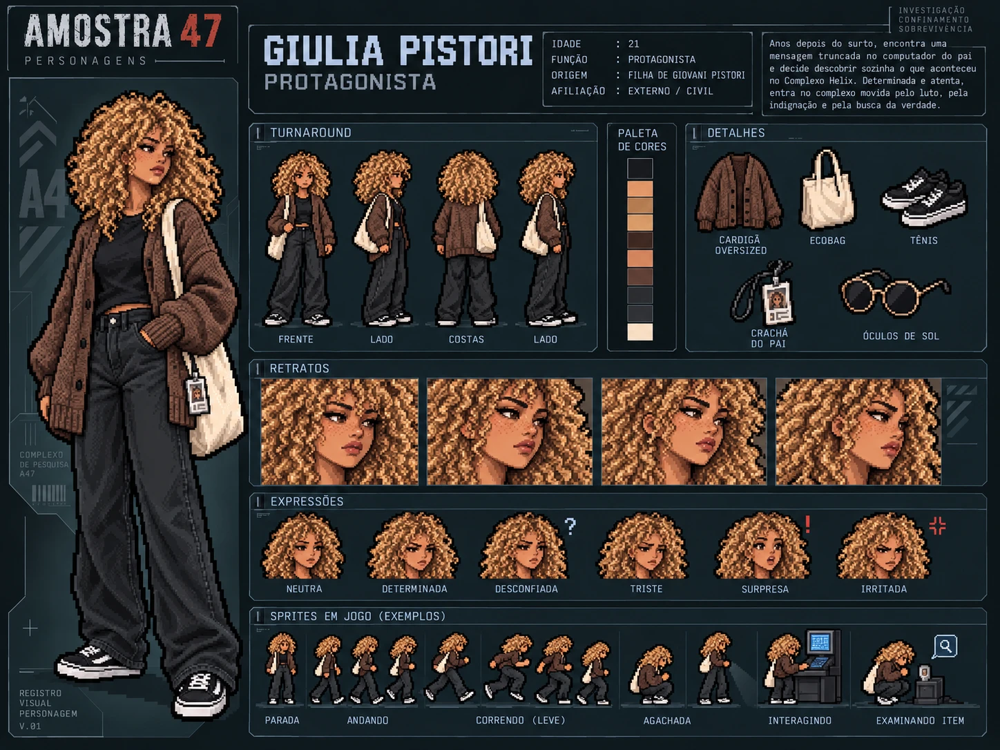

# Giulia Pistori — Protagonista

| | |
|---|---|
| **Papel no jogo** | Protagonista: é quem investiga o Complexo Helix |
| **Família** | Filha de [Giovani Pistori](../giovani-pistori/), chefe de segurança do complexo |
| **Idade** | 21 anos, quando vai investigar o complexo |
| **Época** | Presente, anos depois do surto |

## História

Giulia nasceu quando o pai, Giovani, ainda era muito jovem. A mãe, uma estrangeira que Giovani conheceu nos anos em que viajava como mochileiro, sumiu logo depois do nascimento e nunca mais voltou. Giulia foi criada pelo pai, com a ajuda de uma vizinha idosa que cuidava dela sempre que Giovani trabalhava até tarde no Complexo Helix.

Na noite do incidente, Giovani foi avisado de um problema no complexo e saiu às pressas, deixando Giulia com a vizinha. A última lembrança que ela tem do pai é ele saindo correndo de casa. O complexo foi trancado, ninguém conseguiu fugir, e Giovani morreu junto com todos os outros funcionários.

Anos depois, aos 21 anos, Giulia finalmente mexe nas coisas do pai. No computador de casa, que ninguém nunca abriu, encontra uma mensagem recebida na noite do incidente: remetente sem nome, um código de acesso e algo como *"se acontecer alguma coisa, está tudo no Helix"*. A mensagem chegou depois que Giovani já tinha saído correndo, e por isso ele nunca a leu.

Indignada e em conflito com o rumo da morte do pai, Giulia decide investigar por conta própria.

**Quem mandou a mensagem:** Giulia só descobre dentro do complexo, na Sala de servidores. Foi **Angela Torres**, que trabalhava lado a lado com Giovani. Naquela noite, ao perceber que a diretoria estava manipulando o sistema, Angela tentou alertar a única pessoa em quem confiava fora da direção. O envio foi interrompido quando o complexo foi trancado, e a mensagem chegou truncada. É a *mensagem de emergência interrompida* que aparece nos registros do complexo.

## Na investigação

Giulia precisa investigar o complexo, encontrar pistas e cruzar as informações para descobrir:

- **quem** foi responsável pela liberação da amostra;
- **como** o incidente aconteceu;
- **em qual setor** tudo começou.

A investigação acontece no presente. Durante o jogo, **flashbacks jogáveis** mostram momentos de antes do acidente.

Um dos primeiros itens que ela encontra, na Central de segurança, é o crachá do pai: de um lado, a foto de identificação; do outro, uma foto dos dois juntos.

## Visual

Cachos loiro-mel volumosos e sardas herdados da mãe; raiz escura, sobrancelhas marcadas e olhar sério herdados do pai. Veste cardigã oversized marrom, camiseta preta, calça wide-leg preta, tênis pretos de sola branca e uma ecobag creme. Detalhes, paleta e prompts na [ficha visual](ficha-visual.md); sprites em [`src/jogo/sprites/giulia-pistori/`](../../../src/jogo/sprites/giulia-pistori/).

## Arquivos

| Arquivo | Conteúdo |
|---|---|
| [`ficha-visual.md`](ficha-visual.md) | Especificação visual completa: herança dos traços, roupa, paleta, prompts e critérios de aprovação |
| [`ficha-card.webp`](ficha-card.webp) | Card de personagem: turnaround, paleta, detalhes, retratos, expressões e sprites de exemplo |
| [`sprites/PROMPT.md`](sprites/PROMPT.md) | Prompt dos sprites; os sprites prontos ficam em [`src/jogo/sprites/giulia-pistori/`](../../../src/jogo/sprites/giulia-pistori/) |
