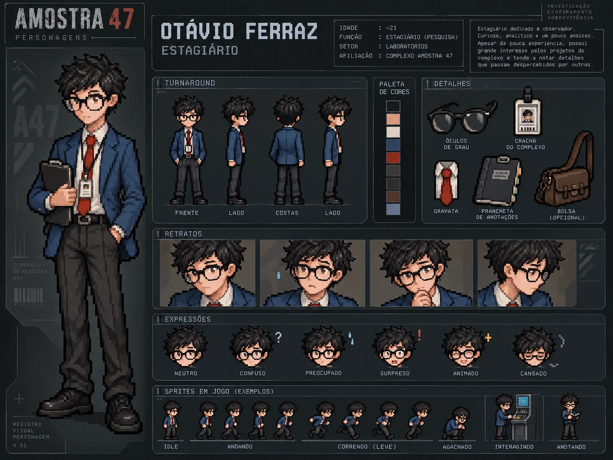

# Otávio Ferraz — Estagiário

| | |
|---|---|
| **Função** | Estagiário de pesquisa |
| **Setor** | Laboratórios |
| **Papel na investigação** | Suspeito descartado: álibi confirmado |
| **Proposições** | W, O |

## Precisar ser útil

Desde pequeno, Otávio Ferraz nunca teve facilidade em fazer amigos. Apesar de curioso, inteligente e dedicado, sempre se sentiu deslocado entre os colegas. Na escola, era frequentemente procurado para ajudar com tarefas e provas, mas raramente lembrado quando o assunto era diversão. Com o tempo, passou a acreditar que precisava ser útil para conquistar a atenção e o carinho das pessoas.

Apesar de inteligente, nunca foi particularmente popular. Era desajeitado nas conversas, falava rápido demais quando se empolgava e tinha o péssimo hábito de corrigir informações sem perceber que estava sendo inconveniente. Seus óculos frequentemente escorregavam pelo nariz, e os cabelos escuros pareciam desafiar qualquer tentativa de permanecer arrumados.

Esse sentimento o acompanhou até a vida adulta, transformando-o em um jovem inseguro, ansioso e excessivamente preocupado em agradar. Otávio tinha dificuldade em dizer não, aceitava responsabilidades além de suas capacidades e interpretava qualquer crítica como uma confirmação de que não era bom o suficiente.

Foi na ciência que encontrou um lugar onde não precisava adivinhar as respostas.

Aos 21 anos, conseguiu uma oportunidade de estágio no Complexo Helix, enxergando nela a chance de finalmente provar seu valor. Em sua aplicação, revisou o currículo tantas vezes que acabou decorando cada palavra. Depois da entrevista, passou dias verificando a caixa de entrada do e-mail, convencido de que havia falado demais, gesticulado demais e provavelmente feito alguma pergunta idiota. Quando recebeu a aprovação, precisou ler a mensagem três vezes.

Ele se dedicava intensamente ao trabalho, buscando constantemente a aprovação dos superiores e o reconhecimento dos colegas. Entretanto, sua necessidade de agradar frequentemente o impedia de questionar decisões, mesmo quando percebia que algo estava errado.

Apesar de suas inseguranças, Otávio era gentil, observador e genuinamente apaixonado pela ciência. No Helix, começou a desenvolver laços verdadeiros com os colegas, encontrando, pela primeira vez, um lugar onde poderia ser valorizado por quem era, e não apenas pelo que fazia. Infelizmente, a tragédia da Amostra 47 interrompeu sua vida antes que pudesse compreender isso completamente.

## A família do Helix

Otávio era o mais novo da equipe e, para Giulia, quase um irmão mais velho. Desenhava com ela, inventava histórias e brincava de esconde-esconde nos corredores permitidos. Com ela, não precisava ser útil nem acertar nada: a menina gostava dele do jeito que ele era. Está na foto da festinha de sete anos de Giulia, com todos juntos.

## História

Otávio circulava por diferentes setores do Complexo Helix e conhecia a rotina dos pesquisadores melhor do que muita gente com mais tempo de casa. Curioso, observador e um pouco ansioso, costumava notar detalhes que passavam despercebidos.

Ele afirma ter deixado o laboratório antes do incidente. Mesmo assim, um registro de acesso encontrado no complexo coloca seu nome entre as cinco hipóteses compatíveis com o horário da liberação, e por isso ele é um dos primeiros suspeitos.

Ao confrontar o álibi com o **relatório de acesso**, Giulia confirma que Otávio realmente saiu antes da liberação da amostra. Se ele fosse o responsável, não poderia ter saído antes. Otávio está fora.

## Destino

Otávio saiu do laboratório antes da liberação, mas ainda estava dentro do complexo quando ele foi trancado. Morreu junto com os demais funcionários, perto de uma das portas, tentando fugir.

**Item pessoal:** a [gravata](../../itens/pessoais/gravata/), encontrada na Sala de evacuação.

## Na investigação

- **Ato I:** aparece entre os sete funcionários listados no terminal recuperado.
- **Ato II:** um registro de acesso levanta suspeita; o relatório de acesso confirma sua saída.
- **Ato III:** é descartado por Modus Tollens.

## Na prova lógica

| Onde | Expressão | Significado |
|---|---|---|
| Premissa 8 | W | Otávio deixou o laboratório antes da liberação. |
| Premissa 11 | O → ¬W | Se fosse o responsável, não teria saído antes. |
| Linha 21 | ¬(¬W) | Dupla Negação. |
| Linha 22 | ¬O | Modus Tollens (11, 21): Otávio não foi o responsável. |

## Identidade visual

1. Cabelo preto curto e bagunçado, com óculos quadrados grandes de armação preta.
2. Blazer azul-marinho, camisa clara e gravata vermelho-queimado.
3. Crachá e prancheta; silhueta esguia e postura um pouco fechada.

## Arquivos

| Arquivo | Conteúdo |
|---|---|
| [`ficha-visual.md`](ficha-visual.md) | Especificação visual completa: aparência, paleta, regras de pixel art, prompts e critérios de aprovação |
| [`ficha-card.webp`](ficha-card.webp) | Card de personagem: turnaround, paleta, acessórios, retratos, expressões e sprites de exemplo |

> A idade mostrada no card é ilustrativa e não faz parte do cânone do caso.
