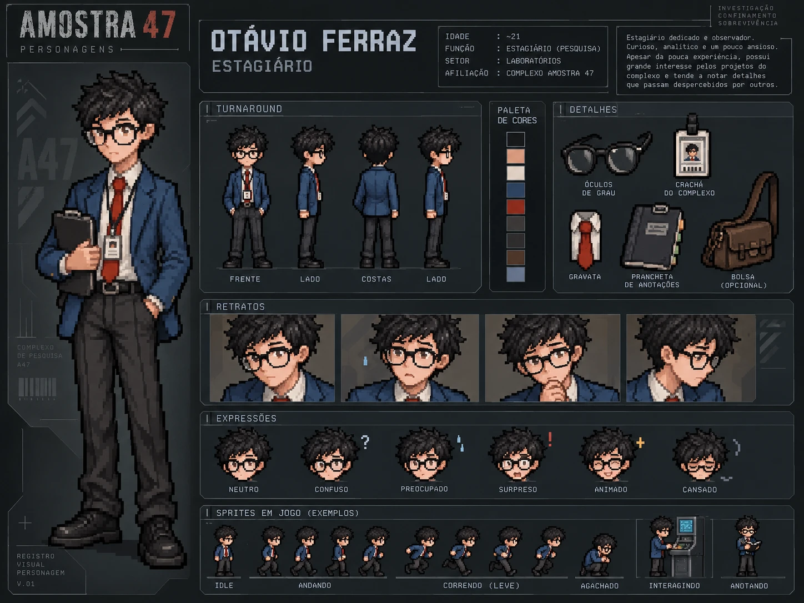

# Otávio Ferraz — Estagiário

| | |
|---|---|
| **Função** | Estagiário de pesquisa |
| **Setor** | Laboratórios |
| **Papel na investigação** | Suspeito descartado: álibi confirmado |
| **Proposições** | W, O |

## História

Otávio circulava por diferentes setores do Complexo Helix e conhecia a rotina dos pesquisadores melhor do que muita gente com mais tempo de casa. Curioso, observador e um pouco ansioso, costumava notar detalhes que passavam despercebidos.

Ele afirma ter deixado o laboratório antes do incidente. Mesmo assim, um registro de acesso encontrado no complexo coloca seu nome entre as quatro hipóteses compatíveis com o horário da liberação, e por isso ele é um dos primeiros suspeitos.

Ao confrontar o álibi com o **relatório de acesso**, o sobrevivente confirma que Otávio realmente saiu antes da liberação da amostra. Se ele fosse o responsável, não poderia ter saído antes. Otávio está fora.

## Na investigação

- **Ato I:** aparece entre os sete funcionários listados no terminal recuperado.
- **Ato II:** um registro de acesso levanta suspeita; o relatório de acesso confirma sua saída.
- **Ato III:** é descartado por Modus Tollens.

## Na prova lógica

| Onde | Expressão | Significado |
|---|---|---|
| Premissa 8 | W | Otávio deixou o laboratório antes da liberação. |
| Premissa 11 | O → ¬W | Se fosse o responsável, não teria saído antes. |
| Linha 20 | ¬(¬W) | Dupla Negação. |
| Linha 21 | ¬O | Modus Tollens (11, 20): Otávio não foi o responsável. |

## Identidade visual

1. Cabelo preto curto e bagunçado, com óculos quadrados grandes de armação preta.
2. Blazer azul-marinho, camisa clara e gravata vermelho-queimado.
3. Crachá e prancheta; silhueta esguia e postura um pouco fechada.

## Arquivos

| Arquivo | Conteúdo |
|---|---|
| [`ficha-visual.md`](ficha-visual.md) | Especificação visual completa: aparência, paleta, regras de pixel art, prompts e critérios de aprovação |
| [`ficha-card.webp`](ficha-card.webp) | Card de personagem: turnaround, paleta, acessórios, retratos, expressões e sprites de exemplo |

> A idade mostrada no card é ilustrativa e não faz parte do cânone do caso.
