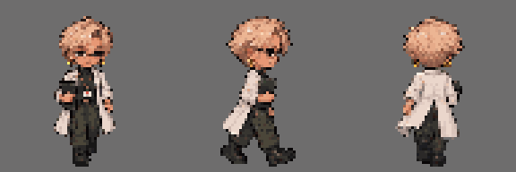

# Sprites — Angela Torres

Sprites de **parado** e **andando**. de frente. lado e costas. no formato da [especificação dos sprites](../../../../docs/personagens/sprites-especificacao.md): quadros de 64 × 64 px e fundo transparente.

| Arquivo | Conteúdo |
|---|---|
| [`angela-sheet.png`](angela-sheet.png) | Folha completa. 384 × 192 px (3 linhas × 6 colunas) |
| `parado-frente.png`. `parado-lado.png`. `parado-costas.png` | Tiras de parado. 2 quadros (128 × 64 px) |
| `andando-frente.png`. `andando-lado.png`. `andando-costas.png` | Tiras de andando. 4 quadros (256 × 64 px) |
| `quadros/` | Os 18 quadros soltos. nomeados `<direção>-<animação>-<n>.png` |
| [`preview-andando.gif`](preview-andando.gif) | Prévia animada do ciclo de andar. ampliada 3× |
| [`PROMPT.md`](../../../../docs/personagens/angela-torres/sprites/PROMPT.md) | Prompt usado para gerar os sprites (fica em `docs/`) |

## Limpeza aplicada

Cada pixel foi convertido para totalmente opaco ou totalmente transparente (corte em 50% de opacidade). para os sprites ficarem nítidos no jogo. sem halo nas bordas. O desenho não mudou.

## Pendências

- No **parado 2**, o corpo inteiro sobe 1 px, inclusive os pés (linha 60 em vez de 61). No jogo, isso aparece como um leve "pulinho" de respiração. Se a ideia for manter os pés fixos, só o tronco deve subir nesse quadro.

- A folha usa cerca de 11.633 cores diferentes. Para seguir a regra de paleta limitada do guia de estilo. ela ainda pode ser reduzida para a [paleta do personagem](../../../../docs/personagens/angela-torres/sprites/PROMPT.md#3-paleta-de-cores) num editor de pixel art.
