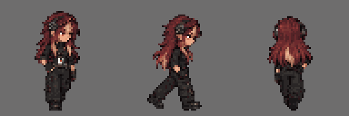

# Sprites — Clara Costa

Sprites de **parado** e **andando**, de frente, lado e costas, no formato da [especificação dos sprites](../../../../docs/personagens/sprites-especificacao.md): quadros de 64 × 64 px e fundo transparente.

| Arquivo | Conteúdo |
|---|---|
| [`clara-sheet.png`](clara-sheet.png) | Folha completa, 384 × 192 px (3 linhas × 6 colunas) |
| `parado-frente.png`, `parado-lado.png`, `parado-costas.png` | Tiras de parado, 2 quadros (128 × 64 px) |
| `andando-frente.png`, `andando-lado.png`, `andando-costas.png` | Tiras de andando, 4 quadros (256 × 64 px) |
| `quadros/` | Os 18 quadros soltos, nomeados `<direção>-<animação>-<n>.png` |
| [`preview-andando.gif`](preview-andando.gif) | Prévia animada do ciclo de andar, ampliada 3× |
| [`prompt.md`](../../../../docs/personagens/clara-costa/sprites/prompt.md) | Prompt usado para gerar os sprites (fica em `docs/`) |
