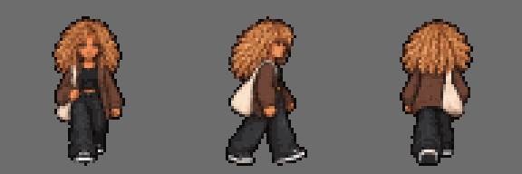

# Sprites — Giulia Pistori

Sprites de **parado** e **andando**. de frente. lado e costas. no formato da [especificação dos sprites](../../../../docs/personagens/sprites-especificacao.md): quadros de 64 × 64 px e fundo transparente.

| Arquivo | Conteúdo |
|---|---|
| [`giulia-sheet.png`](giulia-sheet.png) | Folha completa. 384 × 192 px (3 linhas × 6 colunas) |
| `parado-frente.png`. `parado-lado.png`. `parado-costas.png` | Tiras de parado. 2 quadros (128 × 64 px) |
| `andando-frente.png`. `andando-lado.png`. `andando-costas.png` | Tiras de andando. 4 quadros (256 × 64 px) |
| `quadros/` | Os 18 quadros soltos. nomeados `<direção>-<animação>-<n>.png` |
| [`preview-andando.gif`](preview-andando.gif) | Prévia animada do ciclo de andar. ampliada 3× |
| [`PROMPT.md`](../../../../docs/personagens/giulia-pistori/sprites/PROMPT.md) | Prompt usado para gerar os sprites (fica em `docs/`) |

## Origem e ajustes

Esta é a **versão 2**, que substitui o protótipo v0.1. A arte veio numa folha grande (1774 × 887 px, guardada como [`fonte-alta-resolucao.webp`](fonte-alta-resolucao.webp)), fora do formato do jogo. Para chegar à especificação:

1. Cada uma das 18 figuras foi localizada na folha.
2. Todas foram reduzidas com a **mesma escala**, para a Giulia ficar com cerca de 55 px de altura.
3. Cada quadro foi encaixado em 64 × 64 px, **centralizado pela cabeça** (para ela não balançar de lado ao andar) e com **os pés na linha 60**.

## Limpeza aplicada

Cada pixel foi convertido para totalmente opaco ou totalmente transparente (corte em 50% de opacidade). para os sprites ficarem nítidos no jogo. sem halo nas bordas. O desenho não mudou.

## Pendências

- **Lado esquerdo:** espelhar a vista de lado passa a ecobag para o ombro esquerdo. Para manter a ficha, gerar também o lado esquerdo ou tratar isso no jogo.

- A folha usa cerca de 12.193 cores diferentes. Para seguir a regra de paleta limitada do guia de estilo. ela ainda pode ser reduzida para a [paleta do personagem](../../../../docs/personagens/giulia-pistori/sprites/PROMPT.md#3-paleta-de-cores) num editor de pixel art.
